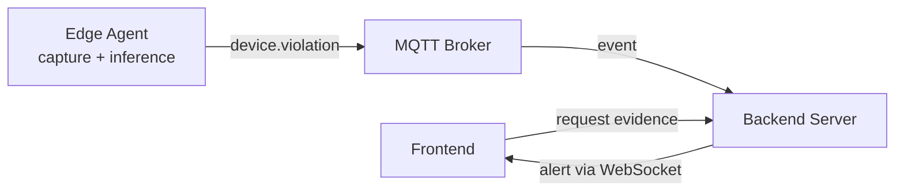
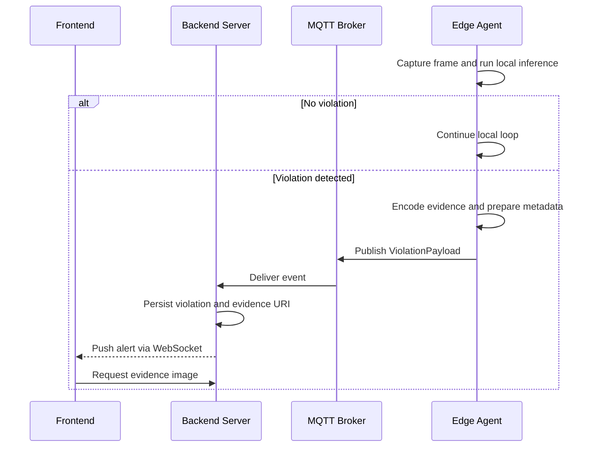

# Edge Inference and Frame Flow

## Current implementation

The edge agent performs inference locally. The current pipeline does **not** send raw video frames to the server.



### Current data path

1. `CameraPipeline` reads a frame from the configured camera or video source.
2. `InferenceRuntime.infer(frame)` runs locally on the edge device.
3. `evaluate_ppe()` converts detections into violation types such as `no_helmet`.
4. A cooldown prevents repeated events for the same violation type.
5. `EdgeLink.send_violation()` publishes a JSON envelope through the configured `MessageBus`.
6. The server validates the payload and stores the violation.

The current payload contains metadata only:

```json
{
  "zone": "line-a",
  "violation_type": "no_helmet",
  "confidence": 0.91,
  "image_path": null,
  "recorded_at": "2026-09-05T10:00:00Z"
}
```

`image_path` is populated when the optional edge evidence uploader successfully
uploads a selected JPEG frame to the server. If upload fails, the violation is
still published with `image_path: null`.

## Recommended frame flow

Raw frames should not be sent through MQTT. A frame can be large, slow, and likely to create backpressure for heartbeat and command traffic.

Recommended flow:



### Recommended responsibilities

```text
CameraPipeline
    capture, inference, rule evaluation, cooldown

EvidenceStore interface
    upload image bytes and return a stable image URI

EdgeLink
    publish event metadata through MessageBus

MQTT
    carry small JSON event metadata, not binary image data

Object storage
    store JPEG/PNG evidence frames

Server Gateway
    validate event, persist metadata, expose image URL or signed URL
```

A reusable interface can be introduced in the edge application:

```python
class EvidenceStore(Protocol):
    async def put(self, data: bytes, *, key: str, content_type: str) -> str: ...
```

Possible implementations:

```text
LocalEvidenceStore       local disk, development only
S3EvidenceStore          S3 or MinIO, recommended for production
HttpEvidenceStore        upload to a server endpoint
```

The current implementation provides a local server evidence endpoint for a
working end-to-end flow. It can later be replaced by an S3/MinIO uploader behind
the same edge-side uploader interface.

The preferred production sequence is:

```text
edge inference -> encode evidence -> object storage -> publish image_uri event
```

## Important design rules

- Keep inference local to reduce bandwidth and latency.
- Send only evidence frames, not the complete video stream.
- Resize or JPEG-compress evidence before upload.
- Use a deterministic object key containing device, camera, timestamp, and event ID.
- Include checksum, content type, and retention metadata when needed.
- Make evidence upload and event publishing retryable and idempotent.
- Do not block heartbeat delivery while uploading a large image.
- Treat the image URI as optional so metadata-only operation remains supported.
