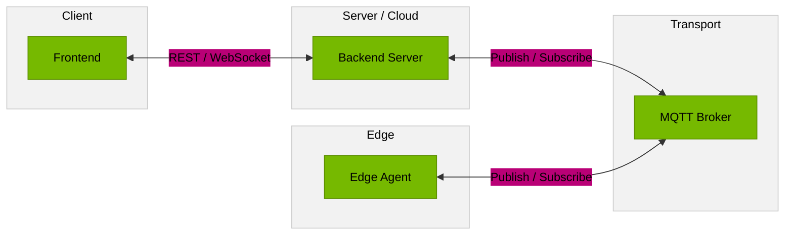
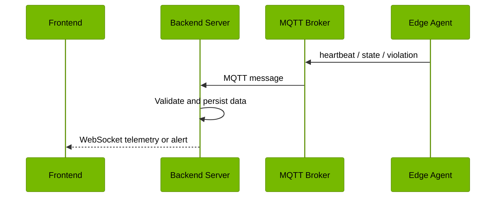
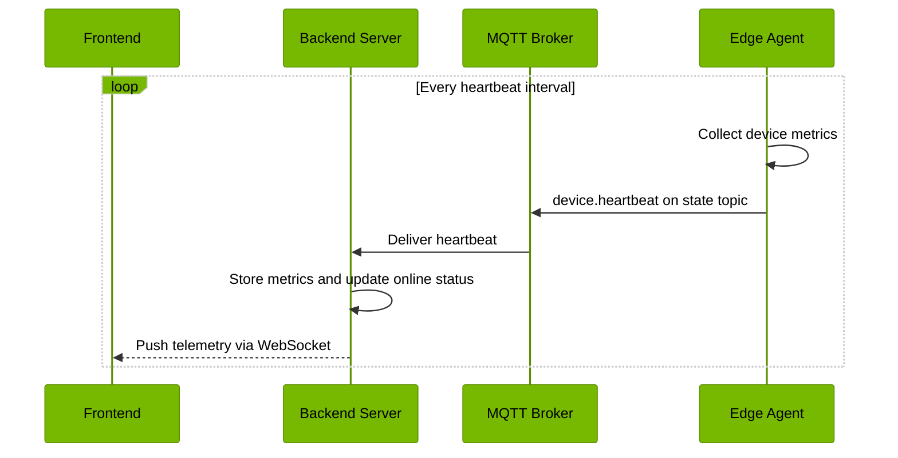
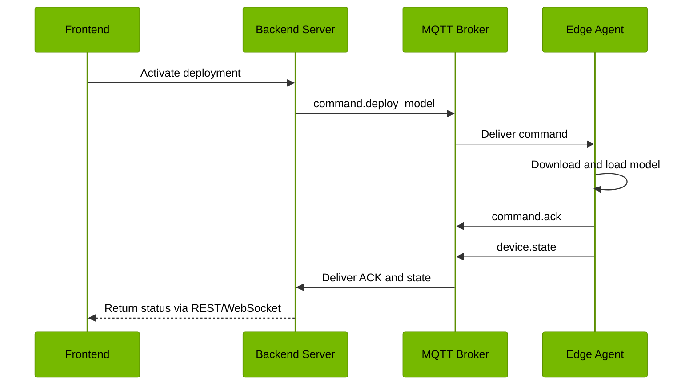
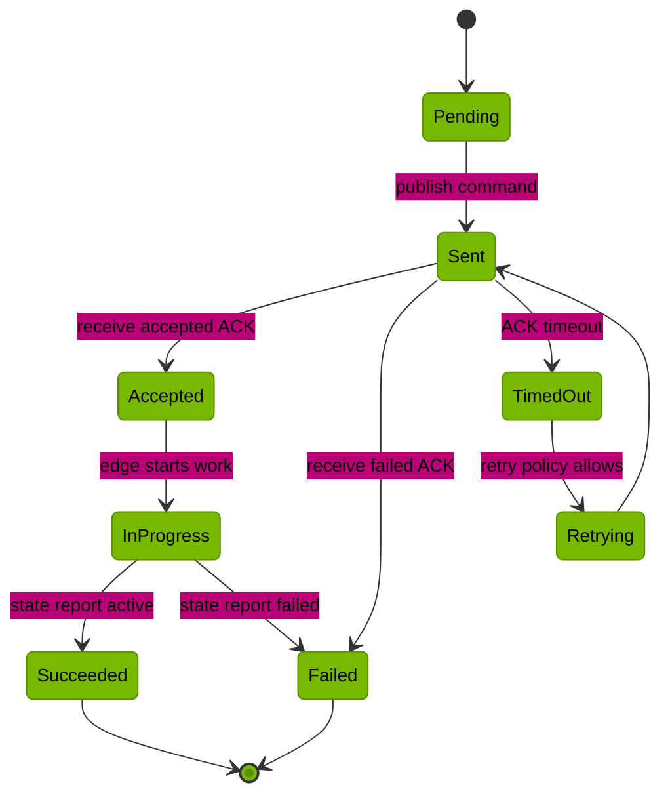
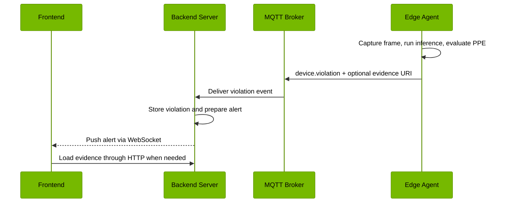

# Edge Agent and Server Communication

## End-to-end communication



The system has four communication actors only:

- **Frontend**: sends user actions and receives dashboard updates.
- **Backend Server**: handles API, business logic, persistence, and realtime relay.
- **MQTT Broker**: transports commands and edge messages.
- **Edge Agent**: runs local inference and reports device state/events.

The PostgreSQL reference schema for the backend is available at
[`schema.sql`](../schema.sql). The application currently creates the same ORM
tables during startup through `init_db()`.

## Topic map

| Direction | Topic | Message types | Purpose |
|---|---|---|---|
| Edge -> server | `agent/devices/{id}/state` | `device.heartbeat`, `device.state` | Health, runtime state, model state |
| Edge -> server | `agent/devices/{id}/events` | `device.violation` | PPE or other detected events |
| Edge -> server | `agent/devices/{id}/logs` | `device.log` | Edge runtime logs |
| Edge -> server | `agent/devices/{id}/telemetry` | `device.telemetry` | Batched metrics |
| Server -> edge | `agent/devices/{id}/cmd` | `command.deploy_model`, `command.update_config`, `command.restart`, `command.run_diagnostics` | Remote commands |
| Edge -> server | `agent/devices/{id}/ack` | `command.ack` | Command result |

## Server to frontend realtime flow

The server does not forward MQTT frames directly to the browser. It validates and
persists the edge message first, publishes an application event, and then a relay
converts that event into a WebSocket envelope.



### Current WebSocket channels

```text
GET /ws/telemetry
    subscribes to telemetry/#
    receives telemetry.device and telemetry.agent

GET /ws/alerts
    subscribes to alerts/#
    receives alert.created

GET /agent/ws/logs
    subscribes to logs/#
    receives device.log
```

The current relays are:

```text
HeartbeatRecorded -> telemetry/{device_id}
HeartbeatRecorded -> telemetry/agent
AlertRaised       -> alerts/{severity}
```

The WebSocket payload is a JSON-encoded `Envelope` sent as a text frame, so the
frontend can parse `event.data` directly.

## Heartbeat flow



## Deployment command flow



## Current implementation caveats

1. The server must use `edge_transport=mqtt` when the edge agent runs with MQTT. If the server uses `InMemoryMessageBus`, it cannot communicate with a separate edge process.
2. `AgentGateway` currently subscribes to state, telemetry, and events. The ACK topic must also be subscribed and handled before command status can be tracked reliably.
3. MQTT reconnect and subscription restoration need to be implemented for production reliability.
4. Heartbeat, command, ACK, and evidence upload should have independent retry/backpressure policies.
5. Correlation IDs should be preserved from the command envelope through the ACK and persisted with the deployment command.

## Recommended command state machine



## Complete inference-to-dashboard flow


