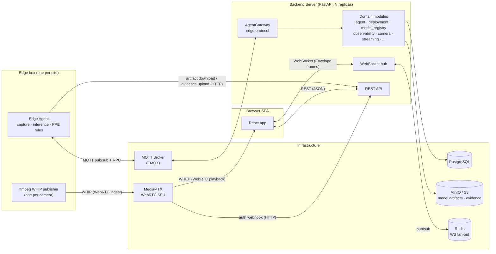
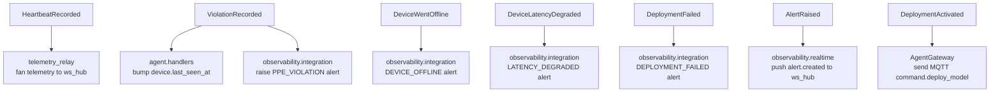

# System Architecture

## Actors and transports



| Link | Transport | Payload | Guarantees |
|---|---|---|---|
| Edge ⇄ Server control plane | MQTT (`agent/devices/{id}/*`) | JSON `Envelope` | at-least-once; commands/violations must not drop |
| Edge → Server (stream token) | MQTT request/reply (RPC) | `StreamTokenRequest` / `StreamTokenReply` | reuses the authenticated MQTT link |
| Edge → Server (artifacts, evidence) | HTTP | model file download, multipart JPEG upload | retryable, idempotent |
| Edge → MediaMTX | WHIP (WebRTC / RTP) | raw H.264 video, one session per camera | best-effort, lossy |
| MediaMTX → Browser | WHEP (WebRTC / RTP) | same video | best-effort, lossy |
| Server ⇄ Browser (queries/commands) | HTTP REST, `ApiResponse` envelope | JSON | request/response |
| Server → Browser (live) | WebSocket, JSON `Envelope` text frames | telemetry / alerts / logs / bbox | best-effort, latest-wins |
| Server replica ⇄ replica (live fan-out) | Redis pub/sub (optional) | `Envelope` | best-effort |

Design rule: **anything needing delivery guarantees (commands, ACKs, violations) rides MQTT or the DB; anything latest-wins (metric samples, bbox overlays, log lines) rides the WS hub / Redis and a dropped frame is corrected by the next one.**

## Backend module map

`backend/server/app`:

```
main.py            FastAPI lifespan: configure logging, init_db, register_event_handlers,
                   connect ws_hub, start EdgePlane
core/
  config.py        single Settings object (env: DB__* MQTT__* REDIS__* S3__*)
  database.py      async SQLAlchemy session + init_db (creates tables on boot)
  events.py        in-process event_bus (publish/subscribe dataclasses)
  ws.py            ws_hub = build_realtime_bus()  (memory | redis)
  ws_auth.py       authenticate_ws: ?token= or Bearer -> User, before accept()
  messaging/       redis_bus.py: cross-replica pub/sub MessageBus for the hub
  auth.py          JWT decode, require_permission dependency
edge/
  runtime.py       EdgePlane: owns the edge MessageBus (memory | mqtt) + AgentGateway
  gateway.py       AgentGateway: MQTT <-> app services; MessageRouter by Envelope.type
domain/
  presence/        PresenceRegistry: online / stale / offline state machine (in-memory)
  reconcile/       generic desired-vs-observed diff -> Plan of CREATE/UPDATE/DELETE
modules/<name>/    router.py (HTTP/WS) · service.py (use-cases) · repository.py (DB)
                   models.py (ORM) · schemas.py (pydantic) · event.py (published events)
                   domain.py (enums/rules) · handlers.py / integration.py / realtime.py (subscribers)
api/router.py      mounts every module router under /api/v1
```

Modules: `auth`, `user`, `system`, `access_control`, `agent` (devices + heartbeats + metrics),
`model_registry`, `deployment`, `observability` (violations + alerts + analytics),
`camera`, `streaming`, `assistant`.

### Module boundaries

- A module reaches another module only through its **public `service.py`**, never its repository.
- Cross-module reactions go through `core.events.event_bus` — a synchronous in-process
  publish/subscribe of frozen dataclasses. Publishers publish *after their own commit*;
  subscribers open their own `session_scope()`.

### Event bus wiring (`register_event_handlers`)



| Event | Publisher | Subscribers |
|---|---|---|
| `HeartbeatRecorded` | `AgentService.record_heartbeat` | `telemetry_relay` → WS `telemetry/{id}` + `telemetry/agent` |
| `DeviceLatencyDegraded` | `AgentService.record_heartbeat` (status → DEGRADED) | `observability.integration` → alert |
| `DeviceWentOffline` | `AgentService.sweep_offline` (periodic job) | `observability.integration` → alert |
| `ViolationRecorded` | `ViolationService.record` | `agent.handlers` (last_seen), `observability.integration` → alert |
| `AlertRaised` | `AlertService.raise_alert` | `observability.realtime` → WS `alerts/{severity}` |
| `DeploymentActivated` | `DeploymentService.activate` | `AgentGateway` → MQTT `command.deploy_model` |
| `DeploymentFailed` | `DeploymentService.mark_failed` | `observability.integration` → alert |

## Edge agent module map

`backend/edge_agent/src/edge_agent`:

```
main.py            wires bus + link + agent + backend + telemetry pump + local API, runs forever
core/
  config.py        AgentSettings (env with __ delimiter); device_id, cameras[], mqtt, vision, streaming
  hardware.py      detect_hardware(): arch, accelerators, encoders, model formats -> DeviceCapabilities
  identity.py      agent_version / primary_ip / uptime_s
  state.py         StateStore: desired vs reported model state, persisted to state.json
network/
  link.py          EdgeLink: heartbeat loop out, command subscription in, ACK back, RPC client
  api.py           local HTTP API (:9100) for a field technician / probes
services/
  agent.py         Agent: executes commands (deploy/update_config/restart/diagnostics), reconcile loop
  backend.py       VisionBackend seam: ComposedBackend (cv2 + ffmpeg) | DeepStreamBackend (Jetson)
  pipeline.py      CameraPipeline: frame -> runtime.infer -> evaluate_ppe -> violation + bbox frame
  telemetry.py     TelemetryPump: fast metric samples (~1s) batched to link.send_telemetry
  evidence.py      HttpEvidenceUploader: POST selected JPEG to server /evidence
  artifacts.py     fetch_artifact(): download + checksum a model file
runtime/           InferenceRuntime: yolo | dummy
streaming/         VideoPublisher: ffmpeg_whip (WHIP via `ffmpeg -f whip`) | null
analytics/ppe.py   detections -> violation types (no_helmet, ...)
```

## Data stores

| Store | Holds | Notes |
|---|---|---|
| PostgreSQL | devices, metric samples (downsampled to ~1/min), deployments, model versions, violations, alerts, users/roles, cameras | tables created by `init_db()` on boot; reference DDL in `schema.sql` |
| MinIO / S3 | model artifacts (`artifact_uri`), evidence images (prod) | edge downloads artifacts by presigned URL |
| Local disk (server) | evidence images (dev, `settings.evidence_dir`) | served from `/evidence/{filename}` |
| Local disk (edge) | `state.json` (desired/reported), downloaded model weights, outbox | survives restart; drives reconcile |
| Redis | transient WS pub/sub only | no durable data; used when `REALTIME_TRANSPORT=redis` |
| MediaMTX | in-flight WebRTC tracks | no persistence |

## Deployment topology

Local dev — `docker compose` from `app/`:

```
docker compose -f docker-compose.data.yml up -d   # Postgres, EMQX, MinIO, Redis, MediaMTX
docker compose up --build                         # + server
docker compose --profile edge up --build          # + edge-agent (end-to-end demo)
```

`docker-compose.yml` just `include:`s `docker-compose.data.yml` + `backend/server/compose.yml`
+ `backend/edge_agent/compose.yml`. Per-service env sits next to each package; shared infra
creds/ports in `app/.env`. The VPS deployment adds the `nginx/` reverse-proxy bundle on top.
