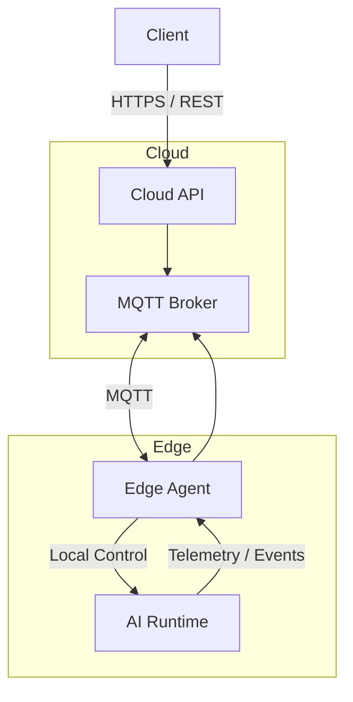
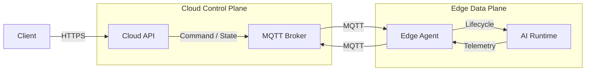
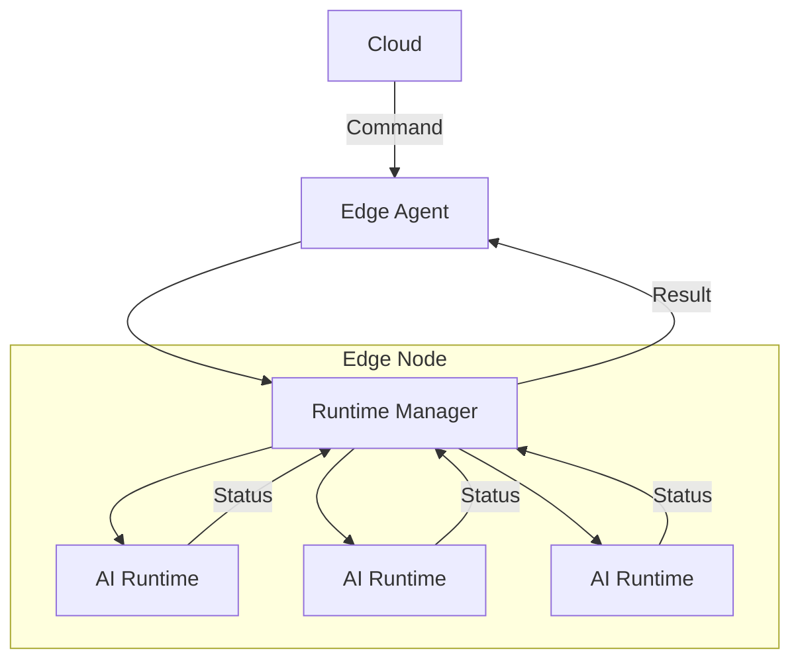
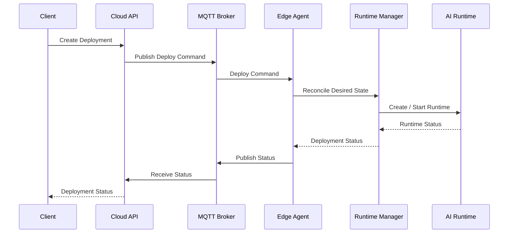
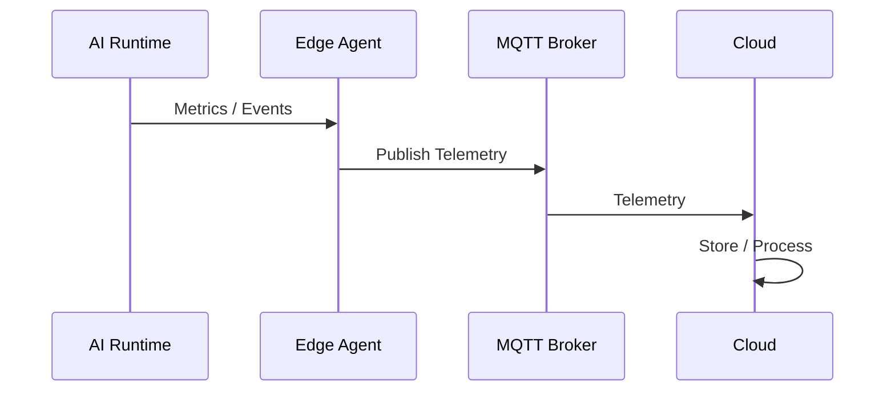

# API Overview

## 1. Overview

The platform exposes APIs for communication between clients, the Cloud Control Plane, and Edge Agents.

The API layer is divided into:

* **Cloud API** — Client communicates with the Cloud.
* **Edge Agent API** — Cloud communicates with an Edge Agent when direct HTTP communication is required.
* **MQTT API** — Cloud and Edge Agents exchange commands, status, telemetry, and events.



---

## 2. API Architecture



The Cloud API is the primary API exposed to clients.

MQTT is used for asynchronous communication between the Cloud and Edge.

---

# 3. Cloud API

The Cloud API provides management and monitoring capabilities for the Edge infrastructure.

### Main resources

```text
/api/v1
├── /clusters
├── /nodes
├── /agents
├── /runtimes
├── /deployments
├── /configs
└── /monitoring
```

### Example endpoints

| Method   | Endpoint                   | Description             |
| -------- | -------------------------- | ----------------------- |
| `GET`    | `/api/v1/clusters`         | List Edge Clusters      |
| `POST`   | `/api/v1/clusters`         | Create an Edge Cluster  |
| `GET`    | `/api/v1/clusters/{id}`    | Get Cluster information |
| `GET`    | `/api/v1/nodes`            | List Edge Nodes         |
| `GET`    | `/api/v1/nodes/{id}`       | Get Node information    |
| `GET`    | `/api/v1/agents/{id}`      | Get Edge Agent status   |
| `GET`    | `/api/v1/runtimes`         | List AI Runtimes        |
| `POST`   | `/api/v1/deployments`      | Create a deployment     |
| `GET`    | `/api/v1/deployments/{id}` | Get deployment status   |
| `DELETE` | `/api/v1/deployments/{id}` | Remove a deployment     |

---

# 4. Edge Agent API

The Edge Agent provides a local management interface for the Edge Node.



### Responsibilities

The Edge Agent API provides operations such as:

```text
GET     /health
GET     /status

GET     /runtimes
GET     /runtimes/{id}

POST    /runtimes
POST    /runtimes/{id}/start
POST    /runtimes/{id}/stop
POST    /runtimes/{id}/restart

PUT     /runtimes/{id}
DELETE  /runtimes/{id}
```

The Edge Agent is responsible for **control and lifecycle management**.

It does not directly execute AI inference.

---

# 5. MQTT API

MQTT is the asynchronous communication interface between the Cloud and Edge Agents.

The topic structure follows the Edge resource hierarchy:

```text
edge/{cluster_id}/{node_id}/...
```

### Topic structure

```text
edge/
└── {cluster_id}/
    └── {node_id}/
        ├── command/
        ├── state/
        ├── telemetry/
        └── event/
```

### Commands

```text
edge/{cluster_id}/{node_id}/command/deploy
edge/{cluster_id}/{node_id}/command/update
edge/{cluster_id}/{node_id}/command/start
edge/{cluster_id}/{node_id}/command/stop
edge/{cluster_id}/{node_id}/command/restart
edge/{cluster_id}/{node_id}/command/remove
```

### State

```text
edge/{cluster_id}/{node_id}/state
edge/{cluster_id}/{node_id}/state/runtime
```

### Telemetry

```text
edge/{cluster_id}/{node_id}/telemetry/system
edge/{cluster_id}/{node_id}/telemetry/runtime
edge/{cluster_id}/{node_id}/telemetry/gpu
```

### Events

```text
edge/{cluster_id}/{node_id}/event/runtime
edge/{cluster_id}/{node_id}/event/error
edge/{cluster_id}/{node_id}/event/deployment
```

---

# 6. Message Flow

### Deployment



### Telemetry



---

# 7. API Principles

The API design follows these principles:

1. **REST for synchronous client operations**
2. **MQTT for asynchronous Cloud–Edge communication**
3. **Versioned API contracts**
4. **Resource-oriented endpoints**
5. **Stateless Cloud API**
6. **Idempotent deployment operations**
7. **Explicit runtime lifecycle states**
8. **Structured error responses**
9. **Authentication and authorization at the API boundary**
10. **Backward-compatible API evolution**

---

# 8. API Documentation

Detailed API contracts are organized as:

```text
docs/
└── api/
    ├── README.md
    ├── cloud-api.md
    ├── agent-api.md
    └── mqtt-topics.md
```

| Document         | Purpose                              |
| ---------------- | ------------------------------------ |
| `README.md`      | API overview and communication model |
| `cloud-api.md`   | Cloud REST API contract              |
| `agent-api.md`   | Edge Agent API contract              |
| `mqtt-topics.md` | MQTT topics and message schemas      |
