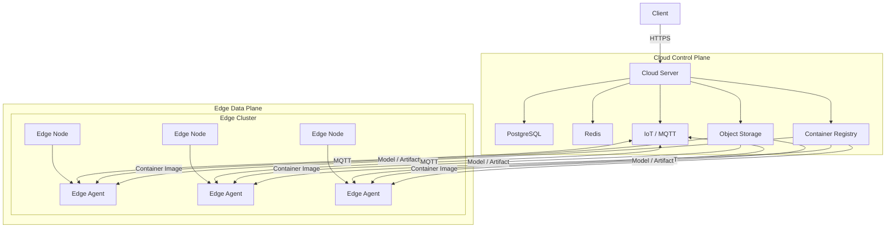
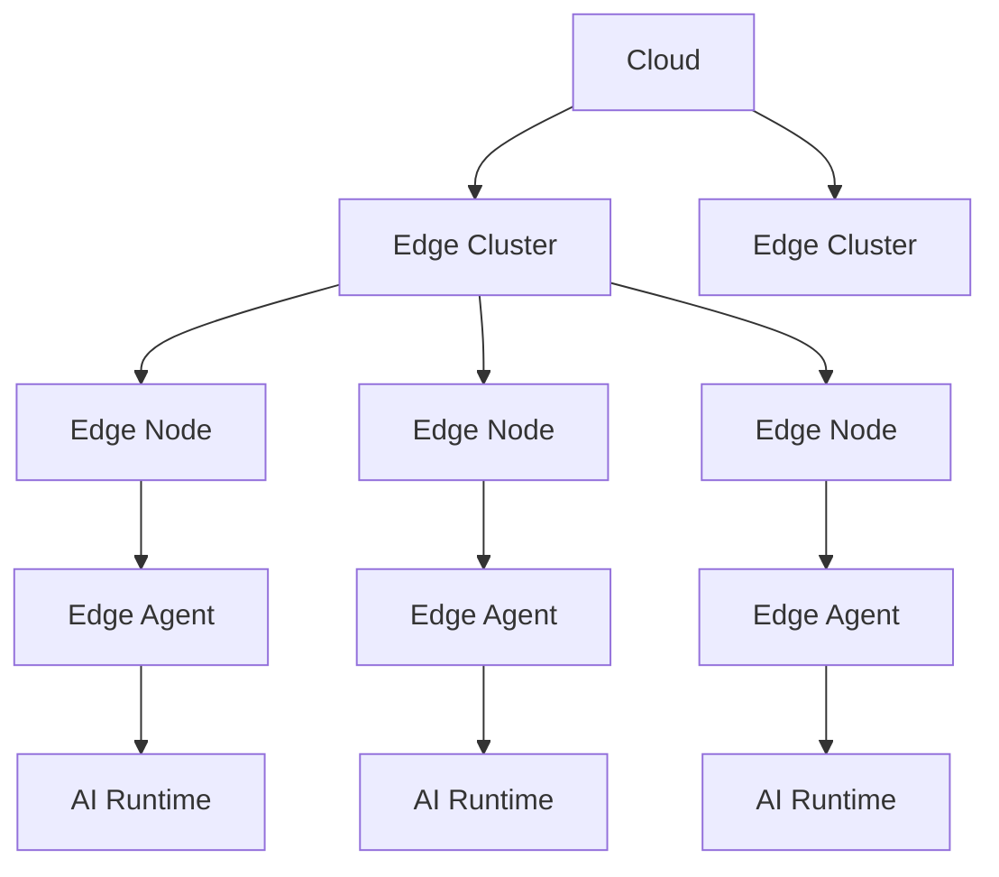
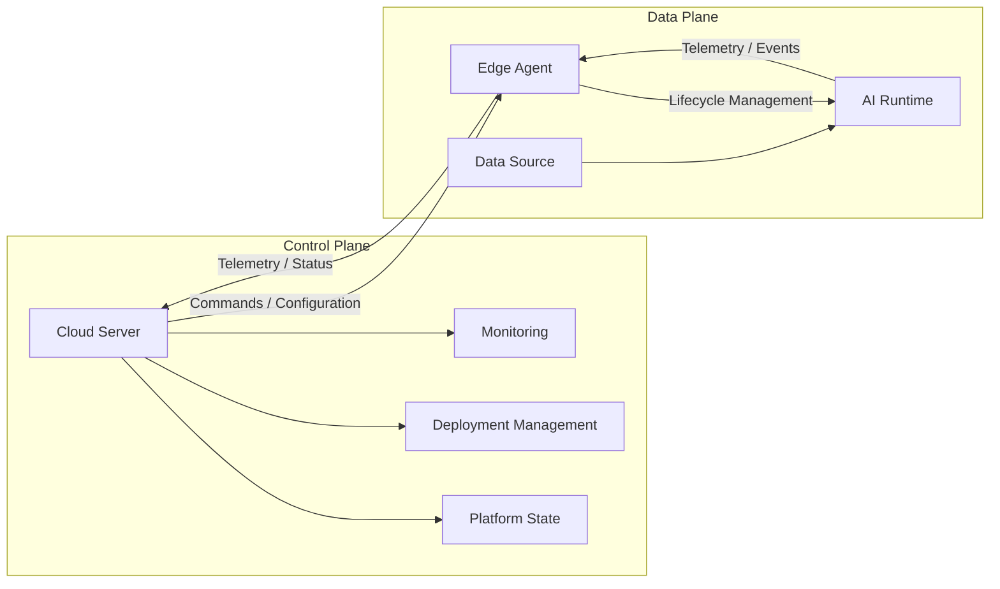
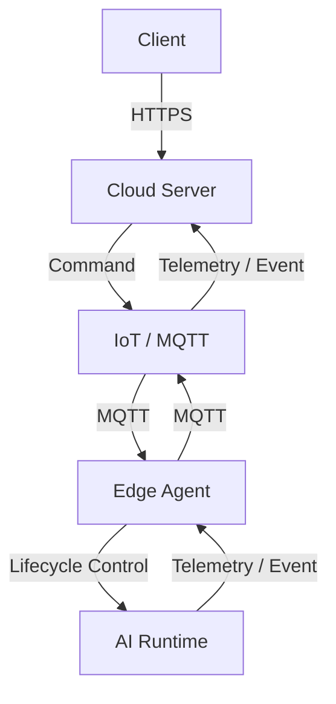

# Architecture Overview

## 1. Overview

The platform follows a **Cloud–Edge architecture** that separates centralized management from distributed AI execution.

* **Cloud** acts as the **Control Plane**.
* **Edge** acts as the **Data Plane**.
* Cloud manages Edge Clusters, Nodes, deployments, configurations, and platform state.
* Edge Nodes execute AI workloads locally through containerized AI Runtimes.

## 2. High-Level Architecture



## 3. Architectural Hierarchy

The platform follows a hierarchical resource model:



The relationships are:

```text
Cloud
  └── Edge Cluster (1:N)
        └── Edge Node (1:N)
              └── Edge Agent (1:1)
                    └── AI Runtime (1:N)
```

## 4. Control Plane and Data Plane



### Control Plane

The Cloud Control Plane is responsible for centralized management:

* Resource management
* Deployment management
* Configuration management
* Desired state
* Monitoring
* Edge coordination

### Data Plane

The Edge Data Plane is responsible for local execution:

* Data processing
* AI inference
* Runtime lifecycle
* Local resource utilization
* Telemetry collection

## 5. Main Architectural Components

| Component          | Responsibility                        |
| ------------------ | ------------------------------------- |
| Cloud Server       | Centralized platform management       |
| Edge Cluster       | Logical grouping of Edge Nodes        |
| Edge Node          | Edge computing resource               |
| Edge Agent         | Node-level control and reconciliation |
| AI Runtime         | AI workload execution                 |
| PostgreSQL         | Persistent platform state             |
| Redis              | Cache and temporary state             |
| Object Storage     | Models and artifacts                  |
| Container Registry | Runtime container images              |
| IoT / MQTT         | Cloud–Edge messaging                  |

## 6. Core Communication

The main communication paths are:



The architecture therefore separates:

**Client → Cloud → Edge Agent → AI Runtime**

for control and execution, while telemetry follows the reverse direction:

**AI Runtime → Edge Agent → Cloud**.
