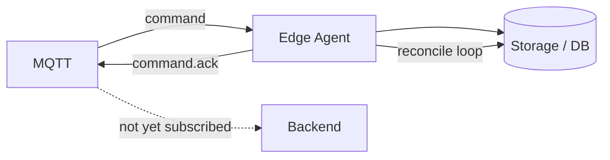
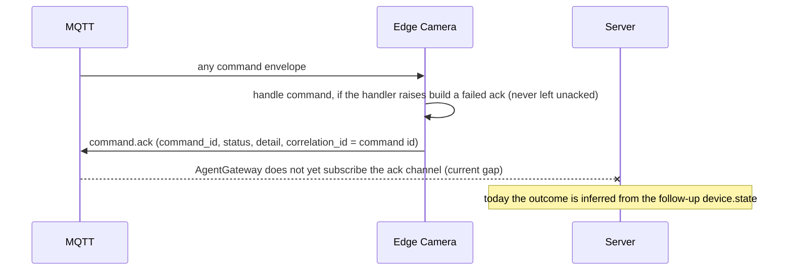
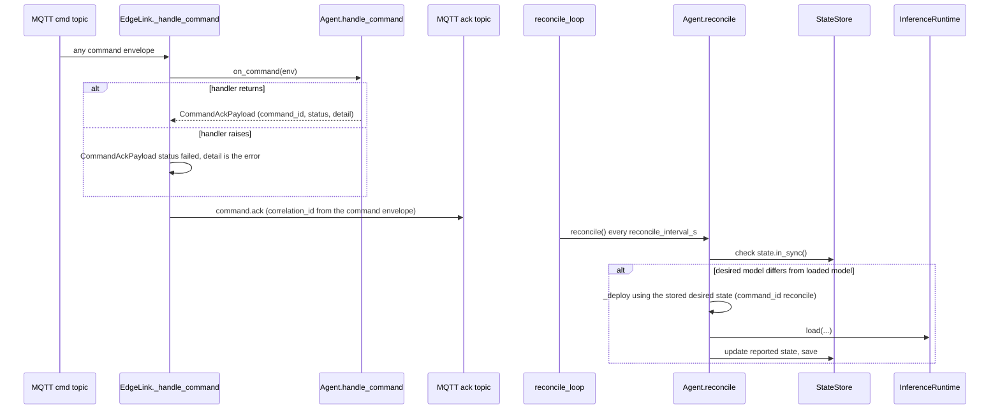

# Flow: command ACK + reconcile

## 1. Overview

**Purpose:**
Two safety nets around remote commands. ACK — the edge always tells the server the outcome
of a command it received. Reconcile — independently of any command, the edge periodically
checks that what it is actually running matches what it was last told to run, and fixes
the gap. Together they make command delivery robust: a command can be lost, a device can
reboot mid-apply, and the system still converges.

**Scope:**
ACK: from a command envelope arriving on `agent/devices/{id}/cmd` to `command.ack` on
`.../ack`. Reconcile: an edge-local loop every `reconcile_interval_s`, no server involved.

**Actors / Components:**

* Edge Camera — `EdgeLink._handle_command`, `Agent.handle_command`, `Agent.reconcile`, `StateStore`
* MQTT — `agent/devices/{id}/cmd` and `.../ack` channels
* Backend — `AgentGateway` (does not yet subscribe `.../ack` — current gap)

---

## 2. High-Level Flow



> Diagram này chỉ thể hiện các component chính. Không đưa class hoặc internal service vào đây.

---

## 3. Sequence Diagram



**Flow (ACK):**

1. Every message on `agent/devices/{device_id}/cmd` is a command. `EdgeLink._handle_command` calls `Agent.handle_command`, which dispatches on `Envelope.type` (`deploy_model`, `update_config`, `restart`, `run_diagnostics`).
2. If the handler returns normally its `CommandAckPayload` is used as-is. If it raises, `_handle_command` catches the exception and builds an ack with `status = "failed"`, `detail = str(exc)` — the edge never leaves a command unacked.
3. The ack is published on `agent/devices/{device_id}/ack` with `correlation_id = env.correlation_id or env.id`.
4. `status` values: `accepted` · `in_progress` · `succeeded` · `failed`.
5. Current gap: `AgentGateway` subscribes state / telemetry / events / logs / bbox but not `agent/devices/+/ack`. The ack is dropped; deployment outcome is inferred from the follow-up `device.state`.

**Flow (Reconcile):**

1. `reconcile_loop` in `edge_agent.main.run` calls `Agent.reconcile()` every `reconcile_interval_s` (default 30 s).
2. `reconcile` returns early if `state.in_sync()`.
3. Otherwise, if there is a `desired.artifact_uri` and `desired.model_version_id != runtime.model_version_id`, it re-runs `_deploy(...)` from the persisted desired state with `command_id = "reconcile"`.
4. Also exposed on the local API: `POST /model/reconcile` on `:9100`.

---

## 4. Component Responsibilities

| Component | Responsibility |
| --- | --- |
| Edge Camera (`_handle_command`) | Dispatch, guarantee an ack even on exception, publish on `.../ack` |
| Edge Camera (`reconcile`) | Compare desired vs loaded model, re-run `_deploy` from persisted state |
| MQTT | Carry commands and acks |
| AgentGateway | (target) subscribe `.../ack`, match by `correlation_id`, drive a state machine, add timeout + retry |

---

## 5. Detailed Service Flow

> Chỉ có section này mới đi sâu vào internal services/classes.



> Target ACK state machine: `Pending → Sent →` (`Accepted →`) `InProgress → Succeeded`,
> with `Failed` on any `failed` ack or `device.state failed`, and
> `Sent → TimedOut → Retrying → Sent` on an ack timeout.

---

## 6. Data Flow

```text
command envelope (MQTT cmd)
  │
  ▼
EdgeLink._handle_command ──► Agent.handle_command ──► handler result or exception
  │
  └── CommandAckPayload ──MQTT (ack)──►  X  (AgentGateway not subscribed, dropped)

reconcile_loop (every 30s)
  │
  ▼
Agent.reconcile ──► state.in_sync()?
     │ no
     ▼
  _deploy(desired, command_id="reconcile") ──► InferenceRuntime.load ──► StateStore.save
```

---

## 7. Error Handling

| Failure | Handling |
| --- | --- |
| Handler raises | `_handle_command` builds a `failed` ack with the error as `detail` |
| Ack lost | No server consumer today anyway; `device.state` is the authoritative signal |
| Command never arrives | Desired state not written, nothing changes; reconcile cannot help without desired state |
| Crash between "told to deploy" and "running it" | Desired state was persisted first, so reconcile re-applies on the next boot + tick |

---

## 8. Observability

**Logs**

* command_id, type, resulting ack status + detail
* reconcile: `in_sync` result, whether `_deploy` was re-run

**Metrics**

* commands handled per type, ack status breakdown
* reconcile runs and re-deploys triggered
* (target) ack round-trip time, ack timeouts

**Tracing**

* MQTT cmd → EdgeLink → Agent handler → MQTT ack
* reconcile_loop → Agent.reconcile → InferenceRuntime.load

---

## 9. Configuration

| Configuration | Description | Default |
| --- | --- | --- |
| `reconcile_interval_s` | Reconcile cadence (edge) | `30` |
| local API | `POST /model/reconcile` on `:9100` | manual trigger |
| (target) ack timeout / retry policy | Not implemented yet | — |

---

## 10. Related Components

* `edge_agent/network/link.py` (`_handle_command`)
* `edge_agent/services/agent.py` (`handle_command`, `reconcile`, `_diagnostics`)
* `edge_agent/main.py` (`reconcile_loop`), `edge_agent/core/state.py` (`in_sync`)
* contract: `edge_protocol/topics.py` (`SUB_ACK`), `edge_protocol/messages.py` (`CommandAckPayload`)
