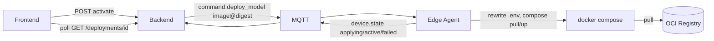

# Flow: deploy model

> **Rewritten for the stateless refactor** (see [`REFACTOR_stateless.md`](../../REFACTOR_stateless.md)).
> The mermaid diagrams further down still show the old `Deployment` row / variant
> pick and are pending a redraw.

## 1. Overview

**Purpose:**
Push a model to an edge device remotely. Deploy is a **command, not a stored row**:
`POST /deployments {device_id, image}` sets `Device.desired_image` and fires
`DeployRequested`; everything after is asynchronous, reconciled by the agent.

The model is one **multi-arch OCI image** per version (`linux/amd64` + `linux/arm64`),
published by a separate pipeline to GHCR with `ai.edge-ops.model.*` labels. The
runtime picks CPU/GPU itself — the server sends one digest-pinned ref. The edge
runs it as the `inference` compose service: rewrite `INFERENCE_IMAGE`,
`docker compose pull`, `up -d --wait`, health-check, roll back on failure.

**Config** sent with the command is resolved server-side:
`model labels < app_settings["inference_policy"] < Device.inference`
(`ConfigResolver`). Editing `Device.inference` later re-resolves and pushes
`T_UPDATE_CONFIG` (no image re-pull).

**Scope:** `DeployService.deploy()` → device reports `runtime_status: active|failed`
(FleetRegistry). Progress is watched over the WS `ack` / `state` stream.

**Actors / Components:**

* Frontend — `POST /deployments`, WS progress
* Backend — `DeployService`, `ConfigResolver`, `ModelCatalog` (GHCR), `AgentGateway`
* MQTT — `agent/devices/{id}/cmd` and `/state`
* Edge Agent — `Agent._deploy`, `ComposeRunner`
* Registry — GHCR `…/ai-edge-ops-model@sha256:…`
* Storage — Postgres (`Device.desired_image`, `audit_logs`), edge `state.json` + `.env.edge`

---

## 2. High-Level Flow



---

## 3. Sequence

```mermaid
sequenceDiagram
    participant FE as Frontend
    participant S as Server
    participant DB as DB
    participant MQTT as MQTT
    participant A as Edge Agent
    participant C as docker compose

    FE->>S: POST activate deployment
    S->>DB: supersede current ACTIVE, set this ACTIVE, commit
    S->>DB: load device (backend), load model version (image_repo, image_*_digest)
    S->>S: variant = gpu if device.backend == "deepstream" else cpu
    S->>MQTT: command.deploy_model { image: repo@<digest>, model_version_id, config }
    MQTT->>A: deliver
    A->>A: persist desired.image, runtime_status="applying" -> device.state
    A->>C: write .env INFERENCE_IMAGE=<image>; docker compose pull inference
    A->>C: docker compose up -d --wait inference
    alt healthy
        A->>A: runtime_status="active", active_model_version_id set
        A->>MQTT: device.state (active) + command.ack succeeded
        A->>C: docker image prune -f
    else pull/up failed or unhealthy
        A->>C: restore .env to previous image; compose up -d
        A->>MQTT: device.state (failed, detail) + command.ack failed
    end
    MQTT->>S: device.state -> AgentGateway; DeploymentFailed -> observability alert
    FE->>S: poll GET /deployments/{id}
```

---

## 4. Component Responsibilities

| Component | Responsibility |
| --- | --- |
| Frontend | Trigger activation, poll status |
| DeploymentService | Deployment state machine, one ACTIVE per device |
| ModelRegistryService | Resolve `image_repo` + per-variant digest (or legacy `artifact_uri`) |
| AgentService | Report `devices.backend` from heartbeat capabilities |
| AgentGateway | Pick the variant by `device.backend`, build + send `command.deploy_model`, observe `device.state`; raise `DeploymentFailed` when no image/artifact is available |
| Edge Agent (`Agent._deploy`) | Persist desired state, drive `ComposeRunner`, report outcome |
| `ComposeRunner` | `.env` rewrite, `compose pull` / `up -d --wait`, rollback, image prune |
| Registry | Immutable digest-addressed model images; signing (cosign, planned) |

---

## 5. Detailed Service Flow

```mermaid
sequenceDiagram
    participant DS as DeploymentService.activate
    participant DB as PostgreSQL
    participant EB as event_bus
    participant G as AgentGateway._on_deployment_activated
    participant MR as ModelRegistryService
    participant AS as AgentService
    participant M as MQTT cmd
    participant AG as Agent._deploy
    participant CR as ComposeRunner
    participant ST as StateStore

    DS->>DB: supersede + ACTIVE + commit
    DS->>EB: DeploymentActivated(deployment_id, device_id, model_version_id, config)
    EB->>G: handle
    G->>AS: get_device(device_id) -> backend
    G->>MR: get_version(model_version_id) -> image_repo, image_cpu_digest, image_gpu_digest, artifact_uri
    G->>G: _select_model_image(version, backend) -> "repo@sha256:.." or None
    alt image or legacy artifact present
        G->>M: DeployModelPayload { image | artifact_uri, model_version_id, config }
        M->>AG: dispatch
        AG->>ST: desired.image=..., reported.runtime_status="applying", save
        AG->>M: device.state (applying)
        alt image path
            AG->>CR: deploy(image)
            CR->>CR: prev = current .env image
            CR->>CR: set INFERENCE_IMAGE=image ; compose pull inference
            CR->>CR: compose up -d --wait inference
            CR-->>AG: DeployResult(ok) | DeployResult(false, detail) + rollback to prev
        else legacy artifact path
            AG->>AG: fetch_artifact(uri) ; runtime.load(...)
        end
        alt ok
            AG->>ST: runtime_status="active", active_model_version_id, save
            AG->>M: device.state (active) + command.ack succeeded
        else failed
            AG->>ST: runtime_status="failed", detail, save
            AG->>M: device.state (failed) + command.ack failed
        end
    else nothing to deploy
        G->>EB: DeploymentFailed(reason="no image for backend / no artifact_uri")
    end
```

---

## 6. Data Flow

```text
Frontend ─POST activate─► DeploymentService.activate
  ├── Deployment rows (SUPERSEDED / ACTIVE) ──► PostgreSQL
  └── DeploymentActivated ─► AgentGateway
        ├── AgentService.get_device      ──► devices.backend  ("composed" | "deepstream")
        ├── ModelRegistryService.get_version ─► image_repo, image_{cpu,gpu}_digest
        └── command.deploy_model { image: repo@digest }  ─MQTT cmd─►
              Agent._deploy
                ├── desired.image ──► state.json
                ├── ComposeRunner ──► /project/.env (INFERENCE_IMAGE=)
                │                     docker compose pull / up -d --wait
                │                     └─ registry pull (layer cache, resumable)
                └── device.state (applying / active / failed) ─MQTT─► AgentGateway ─► PostgreSQL
```

---

## 7. Error Handling

| Failure | Handling |
| --- | --- |
| Model version has no image for this backend and no `artifact_uri` | Gateway raises `DeploymentFailed` → CRITICAL alert; nothing sent to the edge |
| Command lost / edge offline | Nothing acks; desired not on the device → re-send (open item) or reconcile once desired is written |
| `compose pull` fails (registry down, bad digest, auth) | `.env` restored, old image stays up, `runtime_status=failed` with detail |
| `compose up --wait` unhealthy | `.env` restored + `compose up -d` old image, `runtime_status=failed` |
| Edge reboots mid-deploy | On restart the agent reads `state.json`, `reconcile()` re-runs `_deploy(desired.image)` — idempotent (same digest → `ComposeRunner` no-ops) |
| Legacy artifact download / checksum fails | `runtime_status=failed`, previous model keeps running |

---

## 8. Observability

* Logs: `deployment_id`, `device_id`, `model_version_id`, `command_id`, chosen `image` digest, each `runtime_status` transition with `detail`
* Metrics: activate → first `applying` latency; `applying` → `active` duration (pull + up time); deploy success/failure rate; image pull bytes
* Alerts: `DeploymentFailed` → observability `DEPLOYMENT_FAILED`

---

## 9. Configuration

| Configuration | Description | Default |
| --- | --- | --- |
| `compose.project_dir` / `compose.env_file` | Where `compose.yml` + env file live on the edge | `/project`, `/project/.env` |
| `compose.image_var` | Env var the agent rewrites | `INFERENCE_IMAGE` |
| `compose.service` | Compose service to swap | `inference` |
| `compose.up_timeout_s` | Cap on a single `compose` invocation | `180` |
| `reconcile_interval_s` | How fast a stuck / interrupted deploy self-heals | `30` |
| model version `image_repo` / `image_cpu_digest` / `image_gpu_digest` | Per-variant OCI refs (registry / CI) | — |

---

## 10. Related Components

* `app/modules/deployment/service.py` (`activate`), `app/modules/deployment/event.py` (`DeploymentActivated`, `DeploymentFailed`)
* `app/edge/gateway.py` (`_on_deployment_activated`, `_select_model_image`, `_on_heartbeat` → `devices.backend`)
* `app/modules/model_registry/models.py` (`image_repo`, `image_cpu_digest`, `image_gpu_digest`)
* `edge_agent/services/agent.py` (`_deploy`, `_apply_image`, `_apply_artifact`, `reconcile`)
* `edge_agent/runner/compose_runner.py` (`ComposeRunner`)
* `edge_agent/core/config.py` (`ComposeConfig`), `edge_agent/core/state.py` (`DesiredState.image`)
* contract: `edge_protocol/messages.py` (`DeployModelPayload.image`, `DeviceCapabilities.backend`)

---

## 11. Open items (follow-up phase)

* `backend/vision_runtime/` — the buildable that becomes the model images (capture + infer + WHIP), CPU + GPU Dockerfiles
* DeepStream GPU pipeline (currently a skeleton)
* cosign signature verification before `compose up`
* registry credential provisioning on the edge (short-lived token via server)
* `docker-socket-proxy` instead of raw socket mount
* non-blocking legacy `runtime.load`; outbox for at-least-once violations
* reconcile backoff + give-up; `T_UPDATE_CONFIG` hot-apply
