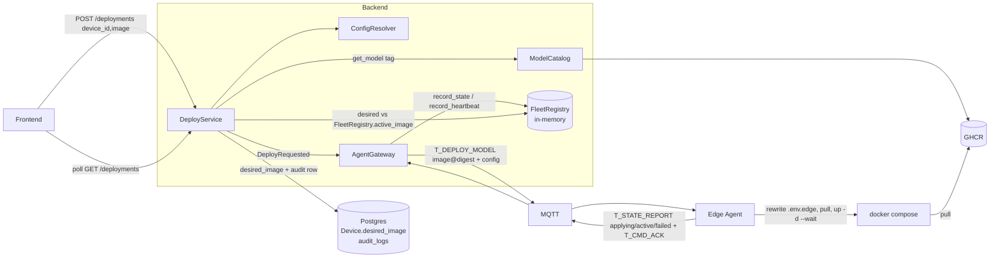

# Flow: deploy model

## 1. Overview

**Purpose:**
Push a model to an edge device remotely — nobody touches the box. Deploy is a
**command, not a stored row**: `POST /deployments {device_id, image}` resolves
the image, sets `Device.desired_image`, and fires `DeployRequested`. Everything
after is asynchronous; the agent reconciles.

The model is **one multi-arch OCI image per version** (`linux/amd64` +
`linux/arm64`), published by a separate pipeline to GHCR with `ai.edge-ops.model.*`
labels. The runtime picks CPU/GPU itself — the server sends one **digest-pinned**
ref. The edge runs it as the `inference` compose service: rewrite
`INFERENCE_IMAGE`, `compose pull`, `up -d --wait`, health-check, roll back on
failure.

**Effective config** is resolved server-side and shipped with the command
(`ConfigResolver`):

```
model labels (ai.edge-ops.model.{conf,iou,imgsz,classes})
  ⊲ app_settings["inference_policy"]   (fleet-wide)
  ⊲ Device.inference                    (per-device operator overrides)   ← wins
```

Editing `Device.inference` later re-resolves and pushes a config-only
`T_UPDATE_CONFIG` (no image re-pull).

**Scope:** `DeployService.deploy()` → device reports `runtime_status:
active|failed` into the in-memory `FleetRegistry`. There is no `Deployment` row
and no per-backend variant pick. Current state = `Device.desired_image` vs
`FleetRegistry.active_image` (`in_sync`). Progress = poll `GET /deployments`.

**Actors / Components:**

* Frontend — `POST /deployments`, poll `GET /deployments`
* Backend — `DeployService`, `ConfigResolver`, `ModelCatalog` (GHCR), `AgentGateway`, `FleetRegistry`
* MQTT — `agent/devices/{id}/cmd` and `/state` + `/ack`
* Edge Agent — `Agent._deploy`, `ComposeRunner`
* Registry — GHCR `ghcr.io/<owner>/ai-edge-ops-model@sha256:…`
* Storage — Postgres (`Device.desired_image`, `audit_logs`), edge `state.json` + `.env.edge`

---

## 2. High-level flow



---

## 3. Sequence — deploy

```mermaid
sequenceDiagram
    participant FE as Frontend
    participant DS as DeployService
    participant MC as ModelCatalog
    participant PG as Postgres
    participant EB as event_bus
    participant GW as AgentGateway
    participant MQ as MQTT
    participant AG as Agent._deploy
    participant CR as ComposeRunner
    participant FR as FleetRegistry

    FE->>DS: POST /deployments {device_id, image:"1.3.0"}
    DS->>DS: AgentService.get_device(device_id)  (404 if unknown)
    DS->>MC: get_model("1.3.0")  → ModelImage(pinned_ref, labels)
    Note over MC: registry 404 → NotFoundError → HTTP 404
    DS->>DS: ConfigResolver.resolve(image, device)  → effective config
    DS->>PG: Device.desired_image = pinned_ref ; AuditLog(deploy.model) ; commit
    DS->>EB: DeployRequested(device_id, pinned_ref, config)
    DS-->>FE: 201 DeploymentView(desired_image, in_sync=false)

    EB->>GW: _on_deploy_requested
    GW->>MQ: T_DEPLOY_MODEL DeployModelPayload{command_id, image, config}

    MQ->>AG: dispatch
    AG->>AG: state.desired.image = image ; reported.runtime_status = "applying"
    AG->>MQ: T_STATE_REPORT (applying)
    AG->>CR: deploy(image)
    CR->>CR: prev = INFERENCE_IMAGE from .env.edge
    CR->>CR: set INFERENCE_IMAGE ; compose --env-file .env.edge pull inference
    CR->>CR: compose up -d --wait inference   (blocks on healthcheck)
    alt healthy
        CR-->>AG: DeployResult(ok)
        AG->>AG: reported.runtime_status = "active" ; reported.active_image = image
        AG->>MQ: T_STATE_REPORT (active) + T_CMD_ACK (succeeded)
        AG->>CR: docker image prune -f
    else pull / up failed or unhealthy
        CR->>CR: restore .env.edge=prev ; compose up -d inference
        CR-->>AG: DeployResult(false, detail)
        AG->>MQ: T_STATE_REPORT (failed, detail) + T_CMD_ACK (failed)
    end

    MQ->>GW: T_STATE_REPORT
    GW->>FR: record_state(device_id, {active_image, runtime_status})
    GW->>EB: DeploymentFailed  (only if runtime_status == "failed")
    FE->>DS: poll GET /deployments  → in_sync once active_image == desired_image
```

---

## 4. Sequence — config change (no redeploy)

```mermaid
sequenceDiagram
    participant FE as Frontend
    participant AS as AgentService.update_device
    participant EB as event_bus
    participant SUB as deployment.subscribers
    participant RES as ConfigResolver.resolve_update
    participant GW as AgentGateway
    participant MQ as MQTT
    participant AG as Agent._update_config

    FE->>AS: PATCH /agent/devices/{id} {inference:{conf_threshold:0.6}}
    AS->>AS: Device.inference = {...} ; commit
    AS->>EB: DeviceConfigChanged(device_id)
    EB->>SUB: _on_config_changed
    SUB->>RES: resolve_update(device)   (inference_policy ⊲ Device.inference)
    SUB->>EB: ConfigResolved(device_id, config)
    EB->>GW: _on_config_resolved
    GW->>MQ: T_UPDATE_CONFIG UpdateConfigPayload{command_id, config}
    MQ->>AG: apply — no image pull
```

---

## 5. Component responsibilities

| Component | Responsibility |
| --- | --- |
| Frontend | `POST /deployments`, poll `GET /deployments`; edit `Device.inference` via `PATCH /agent/devices/{id}` |
| `DeployService.deploy` | Resolve tag → `ModelImage`, set `Device.desired_image`, write `audit_logs`, publish `DeployRequested`. **No row, no state machine.** |
| `ModelCatalog` | Read the tag/manifest/labels from GHCR (v2 API, anon). 404 → `NotFoundError`. |
| `ConfigResolver` | Merge model labels < `inference_policy` < `Device.inference` into the effective config. |
| `AgentGateway` | `DeployRequested` → `T_DEPLOY_MODEL`; `ConfigResolved` → `T_UPDATE_CONFIG`; `T_STATE_REPORT`/heartbeat → `FleetRegistry`; emit `DeploymentFailed` on a reported failure. |
| `FleetRegistry` | In-memory reported state — `active_image`, `runtime_status`, health. Not persisted. |
| `Agent._deploy` | Persist `desired.image`, drive `ComposeRunner`, report `T_STATE_REPORT` + `T_CMD_ACK`. |
| `ComposeRunner` | `.env.edge` rewrite of `INFERENCE_IMAGE`, `compose pull` / `up -d --wait`, rollback to last-known-good, prune. |
| Registry (GHCR) | Immutable digest-addressed multi-arch images; cosign verify (planned). |

---

## 6. Data flow

```text
Frontend ─POST /deployments {device_id, image}─► DeployService.deploy
  ├── ModelCatalog.get_model(tag) ──► GHCR v2 (manifest + config blob labels)
  ├── ConfigResolver.resolve ──► effective = model.labels ⊲ inference_policy ⊲ Device.inference
  ├── Device.desired_image = <ref>@sha256:… ─┐
  ├── AuditLog(action="deploy.model")        ├─► Postgres
  └── DeployRequested ─► AgentGateway
        └── T_DEPLOY_MODEL { image, config } ─MQTT agent/devices/{id}/cmd─►
              Agent._deploy
                ├── desired.image ──► state.json
                ├── ComposeRunner ──► /project/.env.edge (INFERENCE_IMAGE=)
                │                     docker compose --env-file .env.edge pull / up -d --wait
                │                     └─ GHCR pull (layer cache, resumable)
                └── T_STATE_REPORT {active_image, runtime_status} ─MQTT─► AgentGateway
                      └── FleetRegistry.record_state   (in-memory, not persisted)

GET /deployments ─► per-device DeploymentView:
      { device_id, name, desired_image (Postgres), active_image (FleetRegistry),
        runtime_status, in_sync = desired_image == active_image }
```

---

## 7. Error handling

| Failure | Handling |
| --- | --- |
| `image` tag not in the registry | `ModelCatalog` 404 → `NotFoundError` → HTTP 404; nothing changes, no command sent |
| Unknown `device_id` | `AgentService.get_device` → HTTP 404 |
| Command lost / edge offline | Nothing acks; `Device.desired_image` is set, so the agent's `reconcile()` re-applies it once the device is back — idempotent (same digest → `ComposeRunner` no-ops) |
| `compose pull` fails (registry down, bad digest, auth) | `.env.edge` restored, old image stays up, `T_STATE_REPORT(failed, detail)` |
| `compose up --wait` unhealthy | `.env.edge` restored + `compose up -d` old image, `T_STATE_REPORT(failed)` |
| Edge reboots mid-deploy | On restart the agent reads `state.json`; `reconcile()` re-runs `_deploy(desired.image)` |
| Server restarts | `FleetRegistry` empties; refills from the next heartbeat / retained `state`. `Device.desired_image` (Postgres) is untouched. |
| Reported `runtime_status == "failed"` | `AgentGateway` publishes `DeploymentFailed` → observability `DEPLOYMENT_FAILED` (CRITICAL) |

---

## 8. Observability

* Logs: `device_id`, `command_id`, chosen `image` digest, each `runtime_status` transition with `detail`; `audit_logs` row per deploy (`actor` → device → ref)
* Alerts: reported `failed` → `DeploymentFailed` → `DEPLOYMENT_FAILED`
* No deploy-latency metrics yet (was tied to the removed `Deployment` timestamps) — follow-up

---

## 9. Configuration

| Configuration | Description | Default |
| --- | --- | --- |
| `MODEL_REGISTRY__{OWNER,PACKAGE,TOKEN}` | GHCR package the catalog reads (`TOKEN` optional — public) | — / — / empty |
| `COMPOSE__PROJECT_DIR` / `COMPOSE__ENV_FILE` | Where the agent runs `docker compose` on the edge | `/project`, `/project/.env.edge` |
| `COMPOSE__IMAGE_VAR` | Env var the agent rewrites | `INFERENCE_IMAGE` |
| `COMPOSE__SERVICE` | Compose service to swap | `inference` |
| `COMPOSE__UP_TIMEOUT_S` | Cap on one `compose` invocation | `180` |
| `RECONCILE_INTERVAL_S` | How fast a stuck / interrupted deploy self-heals | `30` |
| `app_settings["inference_policy"]` | Fleet-wide config tier (`PATCH /system/settings`) | `{}` |
| `Device.inference` | Per-device config tier (`PATCH /agent/devices/{id}`) | `{}` |

---

## 10. Related components

* `app/modules/deployment/service.py` (`DeployService.deploy` / `list` / `count_active`)
* `app/modules/deployment/config_resolver.py` (`ConfigResolver`)
* `app/modules/deployment/event.py` (`DeployRequested`, `ConfigResolved`, `DeploymentFailed`)
* `app/modules/deployment/subscribers.py` (`DeviceConfigChanged` → `ConfigResolved`)
* `app/modules/model_registry/catalog.py` + `schemas.py` (`ModelCatalog`, `ModelImage`)
* `app/edge/gateway.py` (`_on_deploy_requested`, `_on_config_resolved`, `_on_state_report`)
* `app/modules/agent/fleet_registry.py` (`FleetRegistry.record_state` / `record_heartbeat`)
* `edge_agent/services/agent.py` (`_deploy`, `_update_config`, `reconcile`)
* `edge_agent/runner/compose_runner.py` (`ComposeRunner`)
* contract: `edge_protocol/messages.py` (`DeployModelPayload.image`, `UpdateConfigPayload`, `StateReportPayload.active_image`)

---

## 11. Open items

* MQTT **retained** `state` publish + LWT — needs `svc_core` `MessageBus.publish(retain=)`
* Deploy-progress WS channel (FE polls `GET /deployments` for now)
* cosign signature verification before `compose up`
* private-package pull token minted by the server over the mTLS link
* `docker-socket-proxy` instead of the raw socket mount
* DeepStream GPU pipeline (`Dockerfile.jetson` + `runtime/deepstream.py` skeleton)
* deploy-latency metrics
