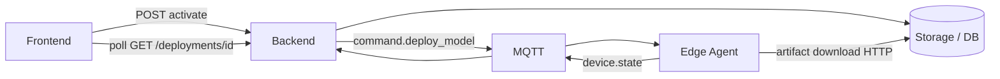
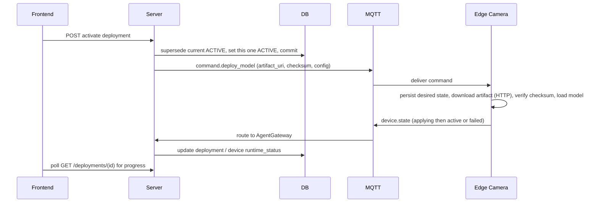
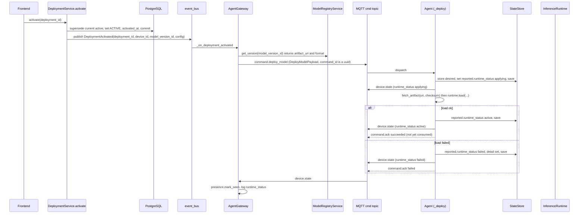

# Flow: deploy model

## 1. Overview

**Purpose:**
Push a specific model version to a specific edge device and have the device load it into
its inference runtime — remotely, with no one touching the box. The operator's action is
a single REST call to activate a `Deployment`; everything after is asynchronous and
eventually-consistent. The server never uploads the model over MQTT — it sends a small
command with an `artifact_uri` pointer; the edge downloads it over HTTP, verifies the
checksum, and loads it.

**Scope:**
Starts at `DeploymentService.activate(deployment_id)`. Ends when the device reports
`runtime_status: active` (or `failed`) and the deployment row settles.

**Actors / Components:**

* Frontend — activate call, status polling
* Backend — `DeploymentService`, `AgentGateway`, `ModelRegistryService`
* MQTT — `agent/devices/{id}/cmd` and `/state` channels
* Edge Camera — `Agent._deploy`, `fetch_artifact`, `InferenceRuntime`
* Storage — PostgreSQL (deployments, versions), S3 / MinIO (artifact), edge `state.json`

---

## 2. High-Level Flow



> Diagram này chỉ thể hiện các component chính. Không đưa class hoặc internal service vào đây.

---

## 3. Sequence Diagram



**Flow:**

1. `DeploymentService.activate` checks the transition is legal, marks any currently ACTIVE deployment for the same device SUPERSEDED, sets this one ACTIVE with `activated_at`, commits, then publishes `DeploymentActivated(deployment_id, device_id, model_version_id, config)`.
2. `AgentGateway._on_deployment_activated` looks up the version via `ModelRegistryService.get_version` for `artifact_uri`, `format`, runtime hints; assembles `DeployModelPayload` with a fresh `command_id`, merging `{...version.runtime_metrics, ...deployment.config}`.
3. The command goes out on `agent/devices/{device_id}/cmd`.
4. `Agent._deploy` writes the desired state to `state.json`, sets `reported.runtime_status = "applying"`, saves, and sends a `device.state` — persisting before doing the work is what makes reconcile able to finish an interrupted deploy.
5. `fetch_artifact(artifact_uri, ...)` downloads over HTTP and verifies the SHA-256 if provided.
6. `InferenceRuntime.load(weights_path, model_version_id, effective_config)` swaps the model in the running pipeline.
7. On success: `runtime_status = "active"`, `active_model_version_id` set, `device.state` sent, `command.ack succeeded`. On failure: `runtime_status = "failed"`, `detail` set, previous model keeps running, `command.ack failed`.
8. `AgentGateway._on_state_report` marks presence and logs the new `runtime_status`; the `command.ack` is currently not consumed ([command-ack](command-ack.md)); the frontend polls `GET /deployments/{id}`.

---

## 4. Component Responsibilities

| Component | Responsibility |
| --- | --- |
| Frontend | Trigger activation, poll deployment status |
| DeploymentService | Run the deployment state machine, enforce one ACTIVE model per device |
| ModelRegistryService | Resolve `artifact_uri`, `format`, runtime hints |
| AgentGateway | Build and send `command.deploy_model`, observe `device.state` |
| Edge Camera | Persist desired state, fetch + verify artifact, load model, report outcome |
| Storage / DB | Deployment / version rows, artifact bytes, edge `state.json` |

---

## 5. Detailed Service Flow

> Chỉ có section này mới đi sâu vào internal services/classes.



---

## 6. Data Flow

```text
Frontend ──POST activate──► DeploymentService.activate
  │
  ├── Deployment rows (SUPERSEDED / ACTIVE) ──► PostgreSQL
  └── DeploymentActivated ──► AgentGateway ──(ModelRegistryService.get_version)──► artifact_uri
        │
        │ command.deploy_model  (MQTT cmd)
        ▼
      Agent._deploy
        ├── desired state ──► state.json (disk)
        ├── fetch_artifact ──HTTP──► S3 / MinIO ──► weights_dir
        ├── InferenceRuntime.load
        └── device.state (applying / active / failed) ──MQTT──► AgentGateway ──► PostgreSQL
```

---

## 7. Error Handling

| Failure | Handling |
| --- | --- |
| Command lost / edge offline | Nothing acks, desired state not on the device, nothing changes; needs re-send (open item) or reconcile if desired was written |
| Download / checksum fails | Reported `failed` with `detail`; old model stays live |
| Edge reboots mid-deploy | On restart the agent reads `state.json`, sees `desired != reported`, reconcile re-runs `_deploy` within `reconcile_interval_s` |
| Load raises | `runtime_status = failed`, pipeline keeps the previous model; `DeploymentFailed` raises a CRITICAL alert |

---

## 8. Observability

**Logs**

* deployment_id, device_id, model_version_id, command_id
* each `runtime_status` transition (applying → active / failed) with `detail`

**Metrics**

* activation → first `applying` latency
* `applying` → `active` duration (download + load time)
* deploy success / failure rate

**Tracing**

* DeploymentService → event_bus → AgentGateway → MQTT → Agent
* Agent → fetch_artifact → S3, Agent → InferenceRuntime.load
* Agent → device.state → AgentGateway

---

## 9. Configuration

| Configuration | Description | Default |
| --- | --- | --- |
| `reconcile_interval_s` | How fast a stuck / interrupted deploy self-heals (edge) | `30` |
| `inference.weights_dir` | Where artifacts land (edge) | edge path |
| model version `checksum_sha256` | Integrity check on download | registry |

---

## 10. Related Components

* `app/modules/deployment/service.py` (`activate`, `mark_failed`), `app/modules/deployment/event.py`
* `app/edge/gateway.py` (`_on_deployment_activated`, `send_command`, `_on_state_report`)
* `edge_agent/services/agent.py` (`_deploy`, `reconcile`)
* `edge_agent/services/artifacts.py` (`fetch_artifact`), `edge_agent/core/state.py` (`StateStore`)
* contract: `edge_protocol/messages.py` (`DeployModelPayload`, `StateReportPayload`, `CommandAckPayload`)
