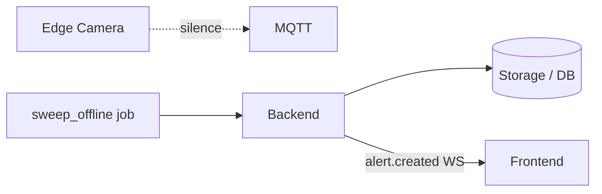
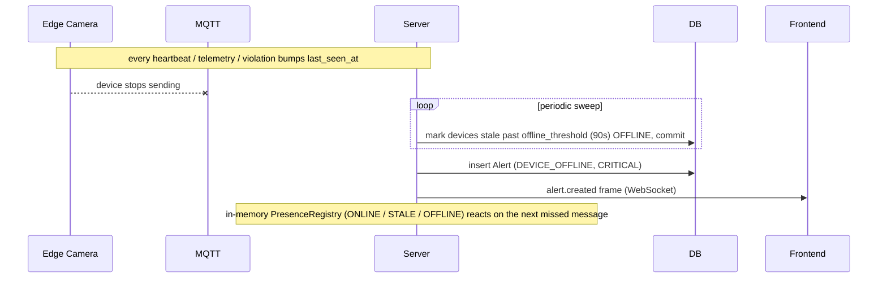
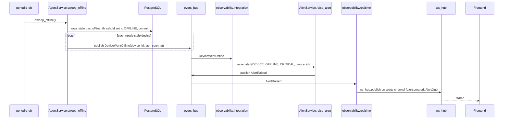

# Flow: device offline / presence

## 1. Overview

**Purpose:**
Detect when an edge device has stopped talking to the platform and react — flip its
status, raise a CRITICAL alert, and let the dashboards grey it out. Two independent
mechanisms answer "is this device present?": the persisted `Device.status` column
(durable, drives the API and alerts) and the in-memory `PresenceRegistry` (reacts to the
very next missed message, finer STALE state).

**Scope:**
Starts when a device stops sending messages. Ends when `Device.status` is OFFLINE, a
`DEVICE_OFFLINE` alert is raised, and the browser greys the device out.

**Actors / Components:**

* Edge Camera — the (now silent) agent
* MQTT — the last-will and the absent traffic
* Backend — `AgentService.sweep_offline`, `PresenceRegistry`, `observability` module
* Storage — PostgreSQL (`Device`, `Alert`)
* Frontend — device cards, alerts panel

---

## 2. High-Level Flow



> Diagram này chỉ thể hiện các component chính. Không đưa class hoặc internal service vào đây.

---

## 3. Sequence Diagram



**Flow:**

1. Every message that proves the device is alive bumps `Device.last_seen_at`: heartbeats, telemetry batches, and violation records.
2. A periodic job calls `AgentService.sweep_offline()`. It selects every device whose `last_seen_at` is older than `now - offline_threshold_seconds` and not already OFFLINE, sets them OFFLINE, commits in one transaction.
3. For each device that just went offline it publishes `DeviceWentOffline(device_id, last_seen_at)`.
4. `observability.integration._on_device_offline` calls `AlertService.raise_alert(DEVICE_OFFLINE, CRITICAL, ...)`, which commits an `Alert` row and publishes `AlertRaised`.
5. `observability.realtime` turns `AlertRaised` into an `alert.created` frame on `alerts/{severity}`.
6. In parallel, `AgentGateway`'s `PresenceRegistry` moves ONLINE → STALE (silent for half the threshold) → OFFLINE (silent past the full threshold); any inbound message returns it to ONLINE. `sweep_presence()` recomputes it on a short timer.

---

## 4. Component Responsibilities

| Component | Responsibility |
| --- | --- |
| Edge Camera | Prove liveness by any inbound message; a crash triggers the MQTT Last-Will |
| MQTT | Deliver the Last-Will `device.state offline` on ungraceful disconnect |
| `sweep_offline` job | Flip stale `Device.status` to OFFLINE, emit `DeviceWentOffline` |
| PresenceRegistry | In-memory ONLINE / STALE / OFFLINE, reacts on the next missed message |
| observability module | Raise the `DEVICE_OFFLINE` CRITICAL alert and push it |
| Storage / DB | Persist `Device.status` and `Alert` rows |
| Frontend | Grey out the device, show the alert |

---

## 5. Detailed Service Flow

> Chỉ có section này mới đi sâu vào internal services/classes.



---

## 6. Data Flow

```text
Edge Camera (silent)
  │
  │ no messages for offline_threshold_seconds
  ▼
sweep_offline() ──► UPDATE Device SET status = OFFLINE ──► PostgreSQL
  │
  └── DeviceWentOffline ──► observability.integration ──► AlertService.raise_alert
                                                              │
                                                              ├── Alert row ──► PostgreSQL
                                                              └── AlertRaised ──► observability.realtime ──► ws_hub ──► Frontend

parallel:
  any inbound message ──► PresenceRegistry.mark_seen ──► ONLINE
  sweep_presence() timer ──► registry.evaluate() ──► STALE / OFFLINE transitions
```

---

## 7. Error Handling

| Failure | Handling |
| --- | --- |
| Server restart | `Device.status` read from DB as-is; presence registry starts empty, repopulates from new messages |
| Flapping device | Each ONLINE → OFFLINE edge raises one alert; recovery does not auto-resolve it, an operator resolves via the alerts API |
| Sweep job not scheduled | `Device.status` never advances to OFFLINE; presence registry still reacts in memory |
| Ungraceful disconnect | Last-Will `device.state offline` (`_on_state_report`) marks presence before the timeout |

---

## 8. Observability

**Logs**

* devices flipped per sweep, with `last_seen_at` age
* presence transitions (ONLINE / STALE / OFFLINE) with device_id

**Metrics**

* sweep duration and rows affected
* count of devices per status
* alert raise latency

**Tracing**

* sweep_offline → event_bus → observability.integration → AlertService → realtime → ws_hub → browser

---

## 9. Configuration

| Configuration | Description | Default |
| --- | --- | --- |
| `offline_threshold_seconds` | The single knob; STALE is always half of it | `90` |
| sweep cadence | Set by whatever schedules `sweep_offline()` / `sweep_presence()` | deployment |

---

## 10. Related Components

* `app/modules/agent/service.py` (`sweep_offline`, `evaluate_status`)
* `app/domain/presence/registry.py` (`PresenceRegistry`)
* `app/edge/gateway.py` (`sweep_presence`, `_on_state_report`, `mark_seen` calls)
* `app/modules/observability/integration.py`, `app/modules/observability/realtime.py`
* `app/modules/agent/handlers.py` (`_on_violation_recorded`)
