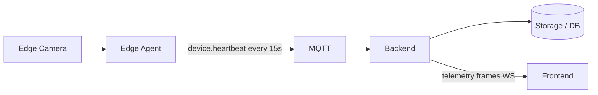
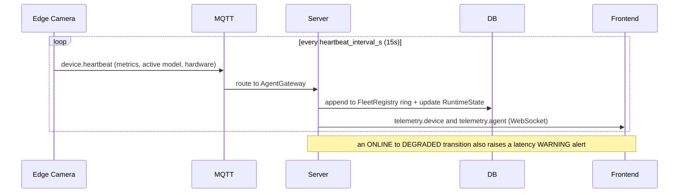
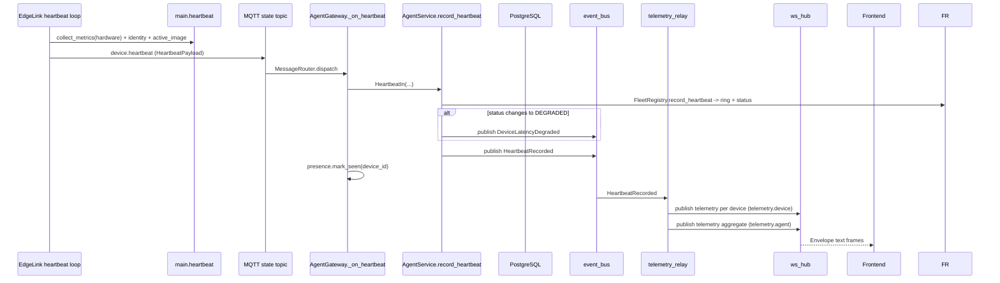

# Flow: health heartbeat

> **Updated for the stateless refactor** ([`REFACTOR_stateless.md`](../../REFACTOR_stateless.md)):
> reported device state (health, status, running image) lives in the in-memory
> `FleetRegistry`, not Postgres; metric samples are a ~15-min ring buffer, not a
> `metric_samples` table; `PresenceRegistry` is gone.
## 1. Overview

**Purpose:**
The heartbeat is the system's "is this device alive and healthy?" signal. Once every
`heartbeat_interval_s` (default 15 s) each edge agent publishes a compact snapshot of its
machine metrics, which model it is running, and its hardware profile. The server keeps
`last_seen_at` fresh for presence detection, stores a time series for the charts, and
raises an alert the moment inference latency crosses the SLO. This is the slow, reliable
path; high-frequency chart data goes through [fast telemetry](telemetry.md).

**Scope:**
Starts at the edge `EdgeLink._heartbeat_loop` tick. Ends when the browser receives the
`telemetry.device` / `telemetry.agent` frames and the device card updates.

**Actors / Components:**

* Edge Camera — `EdgeLink` heartbeat loop, `collect_metrics`, identity
* MQTT — `agent/devices/{id}/state` channel
* Backend — AgentGateway, `AgentService`, `telemetry_relay`
* Storage — Postgres (`Device` desired config only); reported state + metric ring → `FleetRegistry` (in-memory)
* Frontend — device cards, metric sparklines

---

## 2. High-Level Flow



> Diagram này chỉ thể hiện các component chính. Không đưa class hoặc internal service vào đây.

---

## 3. Sequence Diagram



**Flow:**

1. Each tick the edge calls `collect_metrics(hardware)` (CPU, GPU, memory, disk, temperature, FPS, rolling inference latency), stamps identity fields, and copies `active_image` from persisted state.
2. The payload is wrapped in an `Envelope` (`device.heartbeat`) and published fire-and-forget to `agent/devices/{device_id}/state`.
3. `AgentGateway` (subscribed to `agent/devices/+/state`) routes `device.heartbeat` to `_on_heartbeat`, which validates against `HeartbeatPayload`.
4. `AgentService.record_heartbeat` pushes the sample into `FleetRegistry` (ring + `RuntimeState`) and recomputes `status` via `evaluate_status` (ONLINE / DEGRADED / OFFLINE).
5. On an ONLINE → DEGRADED edge it publishes `DeviceLatencyDegraded` (one WARNING alert, on the edge only). It always publishes `HeartbeatRecorded`.
6. `_on_heartbeat` calls `presence.mark_seen(device_id)`.
7. `telemetry_relay` turns `HeartbeatRecorded` into `telemetry.device` on `telemetry/{device_id}` and a fleet aggregate `telemetry.agent` on `telemetry/agent`.

---

## 4. Component Responsibilities

| Component | Responsibility |
| --- | --- |
| Edge Camera | Sample machine metrics, report identity + active model, publish every 15 s |
| MQTT | Carry `device.heartbeat` latest-wins |
| AgentGateway | Route, validate, mark presence |
| AgentService | Push sample into `FleetRegistry`, recompute status, emit events |
| telemetry_relay | Fan the heartbeat to WebSocket telemetry topics |
| Storage / DB | Hold metric history and device state |
| Frontend | Show status dot, last-seen, agent version, IP, sparklines |

---

## 5. Detailed Service Flow

> Chỉ có section này mới đi sâu vào internal services/classes.



---

## 6. Data Flow

```text
Edge Camera
  │
  │ collect_metrics(hardware) + identity + active_image
  ▼
EdgeLink._heartbeat_loop ──► HeartbeatPayload
  │
  │ MQTT (state)
  ▼
AgentGateway._on_heartbeat ──► AgentService.record_heartbeat
  │
  ├── sample ─────► FleetRegistry ring (in-memory, ~15 min)
  ├── Device.status / last_seen_at / identity ─────► PostgreSQL
  └── HeartbeatRecorded ──► telemetry_relay ──► ws_hub
                                                  │
                                                  ├── telemetry/{device_id}  (telemetry.device)
                                                  └── telemetry/agent        (telemetry.agent)
```

---

## 7. Error Handling

| Failure | Handling |
| --- | --- |
| Broker down / packet lost | No retry; a missed tick widens the gap, device may flip OFFLINE and self-recovers on the next beat |
| DB write fails | Exception propagates out of `_on_heartbeat`, logged; next heartbeat is a fresh attempt |
| Ungraceful edge disconnect | MQTT Last-Will posts `device.state` `runtime_status: offline` so a crash is visible before the 90 s timeout |
| Latency alert storm | `DeviceLatencyDegraded` fires only on the transition edge, not on every slow beat |

---

## 8. Observability

**Logs**

* device_id, computed status, status transitions
* latency vs `latency_slo_ms` on a DEGRADED transition

**Metrics**

* heartbeat inter-arrival time per device
* ring append rate
* per-device CPU / GPU / FPS / inference latency (the samples themselves)

**Tracing**

* Edge → MQTT → AgentGateway → AgentService → PostgreSQL
* AgentService → event_bus → telemetry_relay → ws_hub → browser

---

## 9. Configuration

| Configuration | Description | Default |
| --- | --- | --- |
| `heartbeat_interval_s` | How often the beat is sent (edge) | `15` |
| `offline_threshold_seconds` | Age of `last_seen_at` that means OFFLINE (server) | `90` |
| `latency_slo_ms` | Latency above this ⇒ DEGRADED + alert (server) | `80` |

---

## 10. Related Components

* `edge_agent/network/link.py` (`_heartbeat_loop`), `edge_agent/main.py` (`heartbeat`)
* `edge_agent/utils/metrics.py` (`collect_metrics`), `edge_agent/core/identity.py`
* `app/edge/gateway.py` (`_on_heartbeat`)
* `app/modules/agent/service.py` (`record_heartbeat`, `evaluate_status`)
* `app/modules/agent/telemetry_relay.py`
* contract: `edge_protocol/messages.py` (`HeartbeatPayload`, `DeviceCapabilities`)
