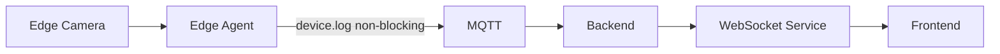
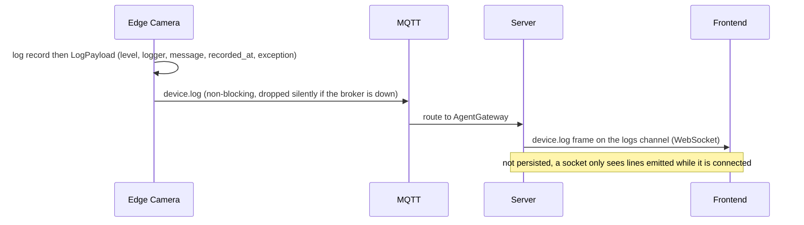
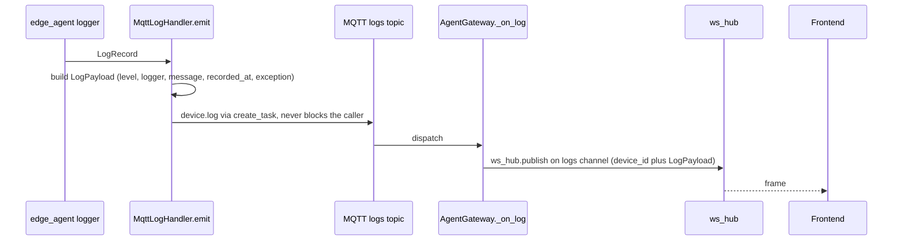

# Flow: log stream

## 1. Overview

**Purpose:**
So an operator can watch what an edge agent is doing without SSH-ing into the box, every
Python log record the agent emits is forwarded to the server and pushed live to any
dashboard with the Logs panel open. This is a convenience / observability stream, not an
audit log — fan-out only, nothing is persisted.

**Scope:**
Starts when the `edge_agent` logger emits a record (with `MqttLogHandler` attached). Ends
when a browser socket on `GET /api/v1/agent/ws/logs` appends the line.

**Actors / Components:**

* Edge Camera — `edge_agent` logger, `MqttLogHandler`
* MQTT — `agent/devices/{id}/logs` channel
* Backend — `AgentGateway._on_log`, `agent/router.py` (`ws_logs`)
* Processing Service — WebSocket Service
* Frontend — live log view

---

## 2. High-Level Flow



> Diagram này chỉ thể hiện các component chính. Không đưa class hoặc internal service vào đây.

---

## 3. Sequence Diagram



**Flow:**

1. During startup `edge_agent.main.run` attaches a `MqttLogHandler` to the `edge_agent` logger (after the MQTT link is up) and removes it on shutdown.
2. `MqttLogHandler.emit` converts the `LogRecord` into a `LogPayload`: `level`, `logger`, rendered `message`, UTC `recorded_at`, and the formatted traceback if present.
3. Because logging must never stall on the network, `emit` schedules the publish as a detached `asyncio.create_task(link.send_log(payload))` with a done-callback that swallows errors.
4. `AgentGateway._on_log` validates the `LogPayload` and republishes on the WS hub topic `logs/{source}`, merging `device_id` into the payload.
5. Any socket on `GET /api/v1/agent/ws/logs` (hub subscription `logs/#`) receives a `device.log` frame and appends it.

---

## 4. Component Responsibilities

| Component | Responsibility |
| --- | --- |
| Edge Camera | Capture every log record, format it, publish without blocking the caller |
| MQTT | Carry `device.log` best-effort |
| AgentGateway | Validate, merge `device_id`, republish on `logs/{source}` |
| WebSocket Service | Fan out `logs/#` to connected browser sockets |
| Frontend | Append lines to the live view; apply the level filter client-side |

---

## 5. Detailed Service Flow

> Chỉ có section này mới đi sâu vào internal services/classes.



---

## 6. Data Flow

```text
edge_agent logger
  │
  │ LogRecord
  ▼
MqttLogHandler.emit ──► LogPayload  ──(asyncio.create_task, non-blocking)──► EdgeLink.send_log
  │
  │ MQTT (logs)
  ▼
AgentGateway._on_log ──► ws_hub topic logs/{source}
  │
  │ WebSocket (no persistence)
  ▼
Frontend live log view
```

---

## 7. Error Handling

| Failure | Handling |
| --- | --- |
| Broker down | Log lines dropped silently on the edge; local stdout / journald still works |
| Publish task errors | Swallowed by the done-callback; logging must not raise or recurse |
| Malformed frame | Frontend ignores frames it cannot parse; one bad line cannot break the stream |
| Socket connected late | Only sees lines emitted while connected (no replay) |

---

## 8. Observability

**Logs**

* this flow *is* the log transport; the server logs only handler attach / detach and validation failures

**Metrics**

* log frames per second per device
* dropped publish tasks
* connected log sockets

**Tracing**

* Edge logger → MQTT → AgentGateway → ws_hub → browser

---

## 9. Configuration

| Configuration | Description | Default |
| --- | --- | --- |
| log level (edge) | What the `edge_agent` logger emits | `INFO` |
| level filter | Applied in the browser, not server-side | UI |
| `MqttLogHandler` lifetime | Attached after MQTT connect, removed on shutdown | automatic |

---

## 10. Related Components

* `edge_agent/network/link.py` (`MqttLogHandler`, `EdgeLink.send_log`)
* `edge_agent/main.py`
* `app/edge/gateway.py` (`_on_log`)
* `app/modules/agent/router.py` (`ws_logs`)
* contract: `edge_protocol/messages.py` (`LogPayload`)
