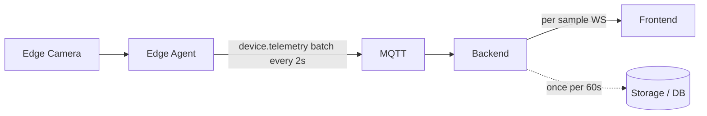
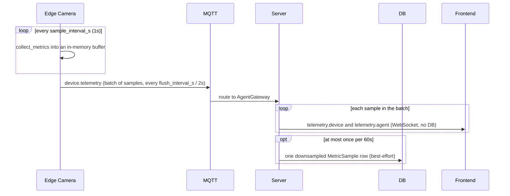
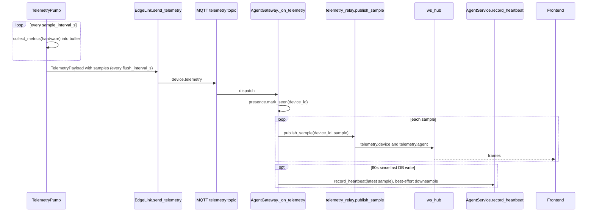

# Flow: fast telemetry

## 1. Overview

**Purpose:**
The metric charts want smooth, ~1-second resolution. Sending a full heartbeat that often
would hammer the database. Fast telemetry samples every second, ships small batches, and
the server fans every sample straight to the dashboards over WebSocket without writing to
the database — except one downsampled row per minute so history survives a page refresh.

**Scope:**
Starts at the `TelemetryPump` sample tick. Ends when the browser receives the
`telemetry.device` / `telemetry.agent` frames. Enabled by `TelemetryConfig.enabled`; off
falls back cleanly to heartbeat-only updates at 15 s.

**Actors / Components:**

* Edge Camera — `TelemetryPump`, `EdgeLink.send_telemetry`
* MQTT — `agent/devices/{id}/telemetry` channel
* Backend — AgentGateway, `telemetry_relay`, `AgentService` (downsample only)
* Storage — PostgreSQL (one `MetricSample` per device per minute)
* Frontend — live sparklines, fleet summary tile

---

## 2. High-Level Flow



> Diagram này chỉ thể hiện các component chính. Không đưa class hoặc internal service vào đây.

---

## 3. Sequence Diagram



**Flow:**

1. `TelemetryPump` wakes every `sample_interval_s` (default 1 s), calls `collect_metrics(hardware)`, appends to an in-memory buffer (pure numbers, no identity fields).
2. Every `flush_interval_s` (default 2 s) it drains the buffer into a `TelemetryPayload{samples: [...]}` and `EdgeLink.send_telemetry` publishes one `Envelope` on `agent/devices/{device_id}/telemetry`.
3. `AgentGateway._on_telemetry` validates the batch and calls `presence.mark_seen` once for the whole batch.
4. For every sample it calls `telemetry_relay.publish_sample(device_id, sample)` — stores it in `_latest[device_id]`, pushes `telemetry.device` and the recomputed `telemetry.agent` aggregate. No DB, no event_bus.
5. If ≥ 60 s since the last write, the gateway runs the last sample through `AgentService.record_heartbeat`, producing one `MetricSample` per device per minute, wrapped in try/except.

---

## 4. Component Responsibilities

| Component | Responsibility |
| --- | --- |
| Edge Camera | Sample metrics at 1 s, batch, publish at 2 s |
| MQTT | Carry `device.telemetry` batches latest-wins |
| AgentGateway | Validate batch, mark presence, drive fan-out and the 60 s downsample |
| telemetry_relay | Push per-sample `telemetry.device` + fleet `telemetry.agent`; hold `_latest` for snapshot |
| Storage / DB | One downsampled row per device per minute |
| Frontend | Render ~1 Hz sparklines and a fleet summary tile |

---

## 5. Detailed Service Flow

> Chỉ có section này mới đi sâu vào internal services/classes.



---

## 6. Data Flow

```text
Edge Camera
  │
  │ collect_metrics every 1s
  ▼
TelemetryPump buffer ──(flush every 2s)──► TelemetryPayload{samples[]}
  │
  │ MQTT (telemetry)
  ▼
AgentGateway._on_telemetry
  │
  ├── each sample ──► telemetry_relay.publish_sample ──► ws_hub ──► Frontend   (hot path, no DB)
  │
  └── last sample, >=60s ──► AgentService.record_heartbeat ──► PostgreSQL       (cold path, best-effort)
```

---

## 7. Error Handling

| Failure | Handling |
| --- | --- |
| Dropped batch | Latest-wins; the next batch (2 s later) supersedes it, charts show a tiny gap |
| DB downsample write fails | Swallowed and logged; live charts unaffected, history misses a minute |
| Slow browser socket | WS hub drops frames for the lagging socket rather than buffering |
| Telemetry disabled | System falls back to heartbeat-only updates at 15 s |

---

## 8. Observability

**Logs**

* batch size, samples dropped, downsample write failures

**Metrics**

* telemetry batch rate and size
* per-sample fan-out latency
* downsample write success rate

**Tracing**

* Edge → MQTT → AgentGateway → telemetry_relay → ws_hub → browser
* AgentGateway → AgentService → PostgreSQL (cold path)

---

## 9. Configuration

| Configuration | Description | Default |
| --- | --- | --- |
| `telemetry.enabled` | Master switch; off ⇒ heartbeat-only | `true` |
| `telemetry.sample_interval_s` | Chart resolution | `1` |
| `telemetry.flush_interval_s` | MQTT message rate vs latency | `2` |
| `_telemetry_persist_gap` | How sparse the history table is (server) | `60s` |

---

## 10. Related Components

* `edge_agent/services/telemetry.py` (`TelemetryPump`)
* `edge_agent/network/link.py` (`send_telemetry`)
* `app/edge/gateway.py` (`_on_telemetry`)
* `app/modules/agent/telemetry_relay.py` (`publish_sample`, `_aggregate`, `snapshot`)
* contract: `edge_protocol/messages.py` (`TelemetryPayload`)
