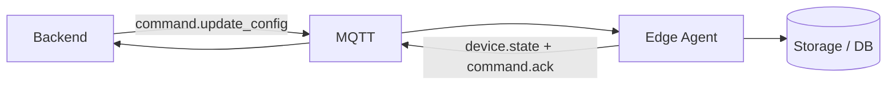
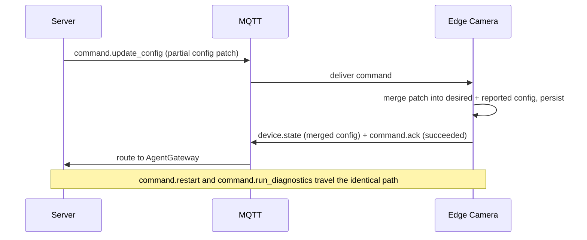
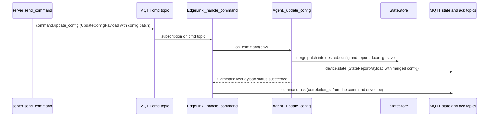

# Flow: update config

## 1. Overview

**Purpose:**
Change how the edge runs inference — confidence threshold, IoU threshold, which PPE
classes are required, other tunables — without redeploying the model. It is the
lightweight sibling of [deploy-model](deploy-model.md): same command channel, same
ack/state pattern, but it only patches a config dict and never touches the runtime or
model weights.

**Scope:**
Starts at `AgentGateway.send_command(device_id, T_UPDATE_CONFIG, ...)`. Ends when the edge
has merged and persisted the patch, reported a `device.state` with the merged config, and
acked.

**Actors / Components:**

* Backend — `AgentGateway.send_command`
* MQTT — `agent/devices/{id}/cmd`, `/state`, `/ack` channels
* Edge Camera — `EdgeLink._handle_command`, `Agent._update_config`, `StateStore`
* (local override) — edge local HTTP API on `:9100`

---

## 2. High-Level Flow



> Diagram này chỉ thể hiện các component chính. Không đưa class hoặc internal service vào đây.

---

## 3. Sequence Diagram



**Flow:**

1. Something on the server calls `AgentGateway.send_command(device_id, T_UPDATE_CONFIG, UpdateConfigPayload{command_id, deployment_id?, config})`. `config` is a partial dict — only the keys to change.
2. `EdgeLink._handle_command` receives it on `agent/devices/{device_id}/cmd` and calls `Agent.handle_command`, which routes `command.update_config` to `_update_config`.
3. `_update_config` does `state.desired.config.update(patch)` and `state.reported.config.update(patch)`, then `store.save()` — updating both halves means reconcile does not see drift; the patch survives a restart.
4. It sends a `device.state` carrying the merged config, then returns `CommandAckPayload(status = succeeded)`.
5. `_handle_command` publishes the ack on `agent/devices/{device_id}/ack` with `correlation_id = env.correlation_id or env.id`.
6. Local override: `PUT /config` on `:9100` does `agent.store.state.desired.config.update(patch)` + save, with no server round-trip.

---

## 4. Component Responsibilities

| Component | Responsibility |
| --- | --- |
| AgentGateway | Build and send `command.update_config` |
| MQTT | Carry the command, the state report, and the ack |
| Edge Camera | Merge the patch into desired + reported config, persist, report, ack |
| local HTTP API | Same knob for a technician standing next to the box |

---

## 5. Detailed Service Flow

> Chỉ có section này mới đi sâu vào internal services/classes.



---

## 6. Data Flow

```text
Server send_command ──► UpdateConfigPayload{config patch}
  │
  │ MQTT (cmd)
  ▼
EdgeLink._handle_command ──► Agent._update_config
  │
  ├── desired.config.update(patch) ──► state.json
  ├── reported.config.update(patch) ──► state.json
  ├── device.state (merged config) ──MQTT──► AgentGateway
  └── command.ack (succeeded) ──MQTT (ack)──► (not yet consumed)

local: PUT /config :9100 ──► desired.config.update(patch) ──► state.json
```

---

## 7. Error Handling

| Failure | Handling |
| --- | --- |
| Unknown config key | Sits in the dict harmlessly; the runtime picks up whatever it recognises next cycle |
| Command lost | No ack; server can resend — the patch is idempotent so resending is safe |
| Handler raises | `_handle_command` builds a `failed` ack with `detail = str(exc)` |
| `command.restart` | Currently a no-op that acks `succeeded` (placeholder) |
| `command.run_diagnostics` | Acks `succeeded` with a short status string |

---

## 8. Observability

**Logs**

* device_id, command_id, the patched keys
* resulting merged config on the `device.state`

**Metrics**

* config commands sent / acked / failed
* command → `device.state` round-trip time

**Tracing**

* send_command → MQTT → EdgeLink → Agent._update_config → StateStore
* Agent → device.state / command.ack → MQTT

---

## 9. Configuration

| Configuration | Description | Default |
| --- | --- | --- |
| `config` patch keys | e.g. `conf_threshold`, `iou_threshold`, `ppe_required` | model-dependent |
| local API port | Field-technician override | `:9100` |
| `correlation_id` | Ties the ack to the command | `env.correlation_id or env.id` |

---

## 10. Related Components

* `edge_agent/services/agent.py` (`_update_config`, `handle_command`)
* `edge_agent/network/link.py` (`_handle_command`)
* `edge_agent/network/api.py` (`put_config`)
* `app/edge/gateway.py` (`send_command`)
* contract: `edge_protocol/messages.py` (`UpdateConfigPayload`)
