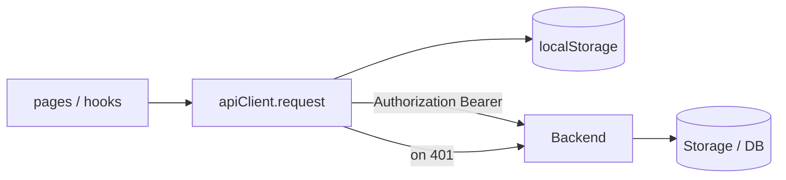
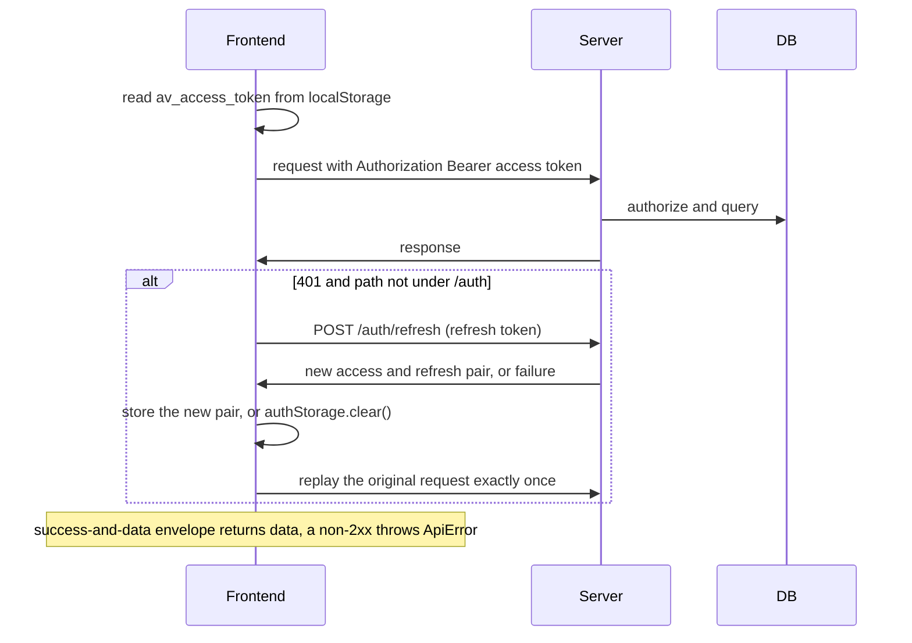
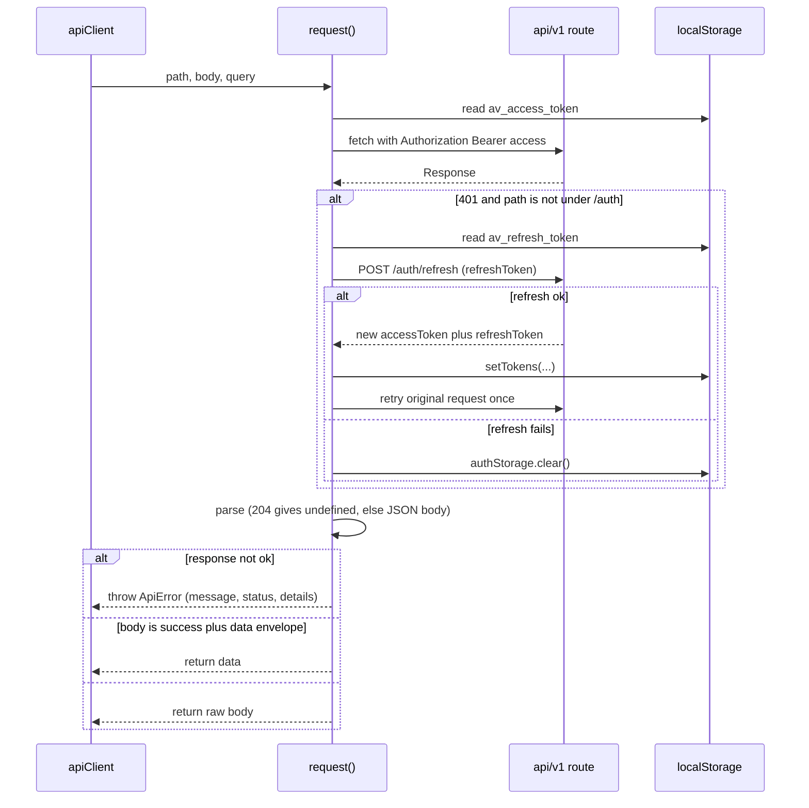

# Flow: REST call + token refresh

## 1. Overview

**Purpose:**
Every query and command the SPA sends to the backend goes through one function,
`request<T>()` in `shared/api/client.ts`. It does four jobs: attach the access token,
unwrap the standard response envelope, transparently refresh an expired token and retry
once, and normalise errors into a typed `ApiError`.

**Scope:**
Starts when `apiClient.get/post/patch/delete` is called. Ends when `request()` returns the
unwrapped `data` or throws `ApiError`.

**Actors / Components:**

* Frontend — `apiClient`, `request()`, `authStorage` (localStorage)
* Backend — `/api/v1/*` routers, `/auth/login`, `/auth/refresh`
* Storage — PostgreSQL (users), browser localStorage (`av_access_token`, `av_refresh_token`)

---

## 2. High-Level Flow



> Diagram này chỉ thể hiện các component chính. Không đưa class hoặc internal service vào đây.

---

## 3. Sequence Diagram



**Flow:**

1. Build the URL. Base is `VITE_API_URL` (default `/api/v1`), trailing slash stripped; `undefined` / `null` query params skipped.
2. Attach auth. The access JWT is read from localStorage under `av_access_token` and sent as `Authorization: Bearer`. `Content-Type: application/json` is added only when there is a body.
3. Send with `fetch`.
4. Refresh-on-401. If the response is 401 and the path is not under `/auth/`: read `av_refresh_token`, `POST /auth/refresh`, on success store the new pair and replay the original request exactly once; on failure `authStorage.clear()` and let the 401 surface.
5. Parse the body. `204` → `undefined`; `application/json` → parsed; else text.
6. Unwrap or throw. `!response.ok` → throw `ApiError { message, status, details }`; `{ success, data }` → return `data`; otherwise return the body as-is.

---

## 4. Component Responsibilities

| Component | Responsibility |
| --- | --- |
| Frontend `request()` | Attach token, refresh + retry once, parse, unwrap or throw |
| `authStorage` | Hold and clear the token pair in localStorage |
| Backend `/auth/refresh` | Issue a fresh `{ accessToken, refreshToken }` pair |
| Backend routers | Enforce auth, return the `ApiResponse` envelope |
| Storage / DB | User records for auth |

---

## 5. Detailed Service Flow

> Chỉ có section này mới đi sâu vào internal services/classes.



---

## 6. Data Flow

```text
pages / hooks ──► apiClient.get/post/patch/delete ──► request()
  │
  ├── localStorage.av_access_token ──► Authorization header
  ├── fetch ──► /api/v1/route ──► (PostgreSQL)
  │
  └── on 401 (not /auth):
        localStorage.av_refresh_token ──► POST /auth/refresh
          ├── ok  ──► setTokens(new pair) ──► replay request once
          └── fail ──► authStorage.clear() ──► 401 surfaces ──► route guard ──► /login
  │
  ▼
parse body ──► { success, data } ? return data : return body   (or throw ApiError)
```

---

## 7. Error Handling

| Failure | Handling |
| --- | --- |
| Access token expired | One transparent refresh + single replay |
| Refresh token also expired | One failed refresh clears both tokens; later calls 401, route guards send to login |
| Concurrent 401s | Each request refreshes independently; last write to localStorage wins (dedupe is a possible improvement) |
| Non-JSON error page (proxy 502) | Falls through to `API request failed with status <n>` |

---

## 8. Observability

**Logs**

* client-side: failed refreshes, `ApiError` status + path
* server-side: `/auth/refresh` outcomes, 401 rate per route

**Metrics**

* refresh rate and refresh-failure rate
* per-route latency and error rate
* logout events from cleared tokens

**Tracing**

* apiClient → fetch → route (Authorization header carries the subject)
* 401 → /auth/refresh → retry

---

## 9. Configuration

| Configuration | Description | Default |
| --- | --- | --- |
| `VITE_API_URL` | REST base | `/api/v1` |
| `av_access_token` / `av_refresh_token` | localStorage keys | fixed |
| access / refresh TTL | Server-side JWT lifetimes | server config |

---

## 10. Related Components

* `frontend/src/shared/api/client.ts`
* `frontend/src/shared/api/services/*` (per-domain wrappers)
* `app/modules/auth/router.py` (`/auth/login`, `/auth/refresh`)
* `dqh.svc_core.transports.http` (`ApiResponse` envelope)
