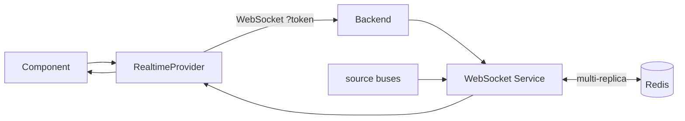
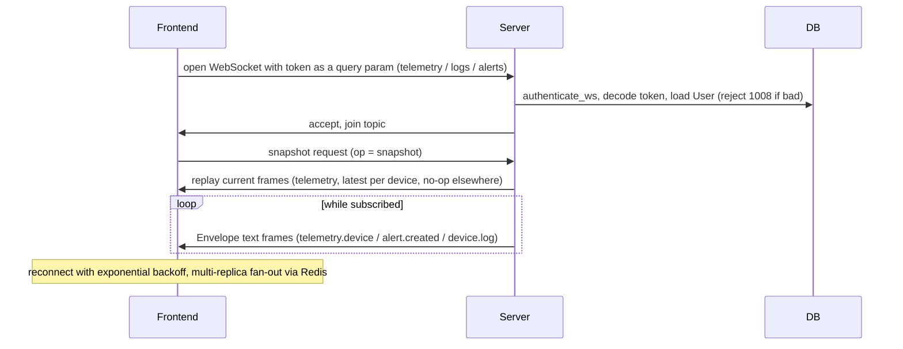

# Flow: WebSocket subscribe

## 1. Overview

**Purpose:**
The SPA needs live pushes for three things: metric telemetry, alerts, and edge logs.
`RealtimeProvider` (`shared/contexts/RealtimeContext.tsx`) manages one WebSocket per
channel, shared by every component that subscribes, with authentication, a
snapshot-on-connect handshake, and automatic reconnect with backoff.

**Scope:**
Starts when a component calls `useRealtimeChannel(channel, handler)`. Ends when the last
handler for a channel unsubscribes and the socket closes.

**Actors / Components:**

* Frontend — `RealtimeProvider`, `useRealtimeChannel`
* Backend — `authenticate_ws`, `ws_hub`, `agent/router.py`, `observability/router.py`
* Processing Service — WebSocket Service (the hub), source buses (telemetry_relay, observability.realtime, `_on_log`)
* Storage — PostgreSQL (users), Redis (multi-replica fan-out)

---

## 2. High-Level Flow



> Diagram này chỉ thể hiện các component chính. Không đưa class hoặc internal service vào đây.

---

## 3. Sequence Diagram



**Flow:**

1. A component calls `useRealtimeChannel(channel, handler)`; the provider adds the handler to that channel's `Set`. The first subscriber opens the socket.
2. `websocketUrl(channel)` builds `ws(s)://<api base><suffix>` and, since browsers cannot set headers on `new WebSocket`, appends the access token as `?token=`.
3. Each `@router.websocket` route calls `authenticate_ws` explicitly (FastAPI dependencies do not run for WS routes). It pulls the token from `?token=` (or a Bearer header), calls `decode_token(..., "access")`, loads the `User`, and rejects with close code 1008 if missing / invalid / inactive. An anonymous socket is allowed only when `ENVIRONMENT=local`.
4. On open the client sends `{"op":"snapshot"}`. For `telemetry` the server replays the current per-device values (`telemetry_relay.snapshot()`); on the other channels it is a no-op.
5. Every frame is a JSON `Envelope` sent as text; `JSON.parse(event.data)` is enough. Malformed frames are caught and ignored. Each parsed message goes to every handler for that channel.
6. The `useEffect` cleanup removes the handler; when the last one goes away the provider clears the reconnect timer, closes the socket, resets to `idle`.

---

## 4. Component Responsibilities

| Component | Responsibility |
| --- | --- |
| Frontend `RealtimeProvider` | One socket per channel, auth via query param, snapshot request, reconnect with backoff |
| `authenticate_ws` | Validate the token before `accept()`, reject with 1008 |
| WebSocket Service (`ws_hub`) | Join topics, fan frames from the source buses to sockets |
| source buses | Produce `telemetry.device` / `alert.created` / `device.log` |
| Storage / DB | User lookup for auth; Redis for cross-replica delivery |

---

## 5. Detailed Service Flow

> Chỉ có section này mới đi sâu vào internal services/classes.

```mermaid
sequenceDiagram
    participant C as Component
    participant P as RealtimeProvider
    participant WA as authenticate_ws
    participant H as ws_hub
    participant B as source bus

    C->>P: subscribe(channel, handler)
    P->>P: first subscriber triggers connect(channel)
    P->>WA: open WebSocket with token query param
    WA->>WA: decode_token, load User, reject 1008 if bad
    WA->>H: accept and join topic (telemetry, alerts or logs)
    P->>H: send op snapshot on open
    H-->>P: replayed current frames (telemetry latest per device, no-op elsewhere)
    B-->>H: publish (telemetry.device, alert.created, device.log)
    H-->>P: Envelope text frame
    P->>C: handler(JSON.parse(event.data))
    C->>P: unmount, unsubscribe; last one closes the socket
```

| channel | URL suffix | server route | frame types |
| --- | --- | --- | --- |
| `telemetry` | `/agent/ws/telemetry` | `agent/router.py::ws_telemetry` | `telemetry.device`, `telemetry.agent` |
| `logs` | `/agent/ws/logs` | `agent/router.py::ws_logs` | `device.log` |
| `alerts` | `/ws/alerts` | `observability/router.py::ws_alerts` | `alert.created` |

---

## 6. Data Flow

```text
Component ──► useRealtimeChannel(channel, handler)
  │
  ▼
RealtimeProvider ──► new WebSocket(url + ?token=access)
  │
  ▼
authenticate_ws ──► decode_token ──► User (PostgreSQL)  |  reject 1008
  │
  ▼
ws_hub join topic ──◄── telemetry_relay / observability.realtime / _on_log
  │                      │
  │                      └── (multi-replica) RedisPubSubMessageBus PSUBSCRIBE / re-filter
  ▼
Envelope text frame ──► JSON.parse ──► every handler for the channel
```

---

## 7. Error Handling

| Failure | Handling |
| --- | --- |
| Missing / invalid / inactive token | Close code 1008 before `accept()` |
| Malformed frame | Caught and ignored so one bad message cannot kill the stream |
| Socket drops (subscribers remain) | `onclose` schedules reconnect with backoff `min(500ms * 2^attempt, 8000ms)`; `onopen` resets the counter |
| Multi-replica: push on another replica | `REALTIME_TRANSPORT=redis` — `RedisPubSubMessageBus` re-filters each delivery through `topic_matches` |
| No subscribers left | Reconnect timer cleared, socket closed, state `idle` |

---

## 8. Observability

**Logs**

* auth rejects (1008) with reason
* connect / disconnect per channel, reconnect attempts

**Metrics**

* open sockets per channel
* frames delivered per channel per second
* reconnect rate, snapshot replay size

**Tracing**

* source bus → ws_hub → socket
* (multi-replica) producing replica → Redis → consuming replica → socket

---

## 9. Configuration

| Configuration | Description | Default |
| --- | --- | --- |
| `ENVIRONMENT` | `local` allows anonymous sockets | not local |
| `REALTIME_TRANSPORT` | `memory` or `redis` for multi-replica fan-out | `memory` |
| reconnect backoff | `min(500ms * 2^attempt, 8000ms)` | fixed |

---

## 10. Related Components

* `frontend/src/shared/contexts/RealtimeContext.tsx`
* `app/core/ws_auth.py` (`authenticate_ws`), `app/core/ws.py` (`ws_hub = build_realtime_bus()`)
* `app/core/messaging/redis_bus.py`
* `app/modules/agent/router.py`, `app/modules/observability/router.py`
* `dqh.svc_core.transports.websocket` (`serve_ws`, `WebSocketMessageBus`)
