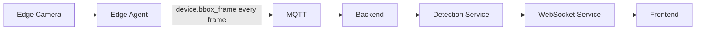
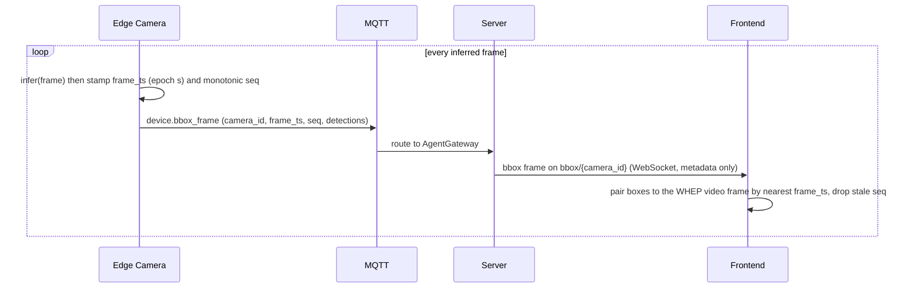
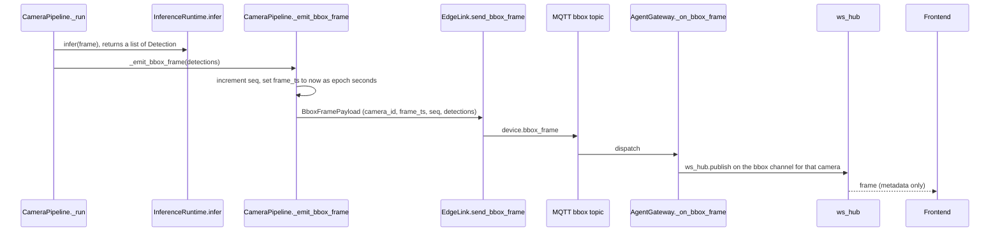

# Flow: live bbox overlay

## 1. Overview

**Purpose:**
Draw the model's detection boxes on top of the live camera video in the browser. Video
and boxes travel over two unsynchronised transports — video over WebRTC through MediaMTX,
detections over MQTT then WebSocket — so the detection metadata carries a timestamp and
the frontend lines each box set up with the right video frame client-side.

**Scope:**
Starts when `CameraPipeline._run` produces detections for a frame. Ends when the browser
renders those boxes over the matching video frame. Detections are sent for every inferred
frame, unconditionally (unlike violations).

**Actors / Components:**

* Edge Camera — inference, `_emit_bbox_frame`
* MQTT — `agent/devices/{id}/bbox` channel
* Backend — AgentGateway (pure relay)
* Processing Service — Detection Service, WebSocket Service
* Frontend — live monitor panel (WHEP video + bbox overlay)

---

## 2. High-Level Flow



> Diagram này chỉ thể hiện các component chính. Không đưa class hoặc internal service vào đây.

---

## 3. Sequence Diagram



**Flow:**

1. `CameraPipeline._run` pulls a frame at `fps_limit` and runs `runtime.infer(frame)`, getting a `list[Detection]` with normalised `(x1,y1,x2,y2)` bboxes.
2. `_emit_bbox_frame` increments `seq`, takes wall-clock epoch seconds as `frame_ts`, and builds a `BboxFramePayload`.
3. One `Envelope` (`device.bbox_frame`) is published per frame on `agent/devices/{device_id}/bbox` — small JSON, no image data.
4. `AgentGateway._on_bbox_frame` validates and republishes verbatim on the WS hub topic `bbox/{camera_id}` (keyed by camera).
5. The panel, subscribed to both the WHEP video and the `bbox/{camera_id}` channel, picks the payload whose `frame_ts` is closest to the on-screen frame and draws the boxes; `seq` discards late/out-of-order frames.

---

## 4. Component Responsibilities

| Component | Responsibility |
| --- | --- |
| Edge Camera | Infer per frame, stamp `frame_ts` + `seq`, publish metadata |
| MQTT | Carry `device.bbox_frame` best-effort |
| Detection Service | Validate `BboxFramePayload`, republish verbatim |
| WebSocket Service | Fan out `bbox/{camera_id}` to subscribed browser sockets |
| Frontend | Pair boxes to the displayed video frame by `frame_ts`, render, drop stale `seq` |

---

## 5. Detailed Service Flow

> Chỉ có section này mới đi sâu vào internal services/classes.



---

## 6. Data Flow

```text
Edge Camera
  │
  │ frame
  ▼
InferenceRuntime.infer ──► list[Detection]  (bbox normalised 0..1)
  │
  ▼
CameraPipeline._emit_bbox_frame ──► BboxFramePayload (camera_id, frame_ts, seq)
  │
  │ MQTT (bbox)
  ▼
AgentGateway._on_bbox_frame ──► ws_hub topic bbox/{camera_id}
  │
  │ WebSocket (metadata only, no persistence)
  ▼
Frontend ──► pair with WHEP video by nearest frame_ts ──► draw boxes
```

---

## 7. Error Handling

| Failure | Handling |
| --- | --- |
| Bbox channel drops frames | Overlay updates less often; video unaffected |
| No `bbox` sink / streaming disabled | `_emit_bbox_frame` is a no-op; violations still work |
| Clock-skewed edge box | Constant overlay offset; acceptable for monitoring, fixable with NTP |
| Malformed frame at the browser | Frame ignored, stream continues |

---

## 8. Observability

**Logs**

* camera_id, seq, detection count per emitted frame (debug level)
* dropped / out-of-order `seq` on the frontend

**Metrics**

* bbox frames published per second per camera
* MQTT → WebSocket relay latency
* frontend pairing skew (video ts − bbox `frame_ts`)

**Tracing**

* Edge → MQTT → AgentGateway → ws_hub → browser (metadata path only; video path is separate)

---

## 9. Configuration

| Configuration | Description | Default |
| --- | --- | --- |
| `inference.fps_limit` | Frame rate fed to inference / bbox emit | edge-configured |
| `bbox` sink | Wired by `ComposedBackend` when streaming is enabled | on with streaming |
| skew tolerance | Frontend pairing window between video and `frame_ts` | frontend constant |

---

## 10. Related Components

* `edge_agent/services/pipeline.py` (`_run`, `_emit_bbox_frame`)
* `edge_agent/network/link.py` (`send_bbox_frame`)
* `app/edge/gateway.py` (`_on_bbox_frame`)
* `ui/src/modules/agent/components/LiveMonitorPanel.tsx`
* contract: `edge_protocol/messages.py` (`BboxFramePayload`, `BboxPayload`)
