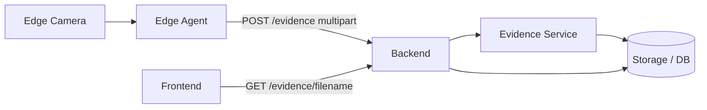
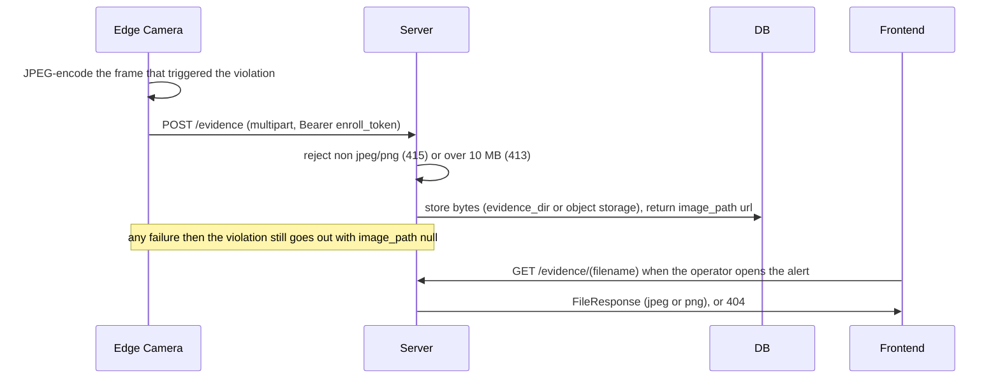
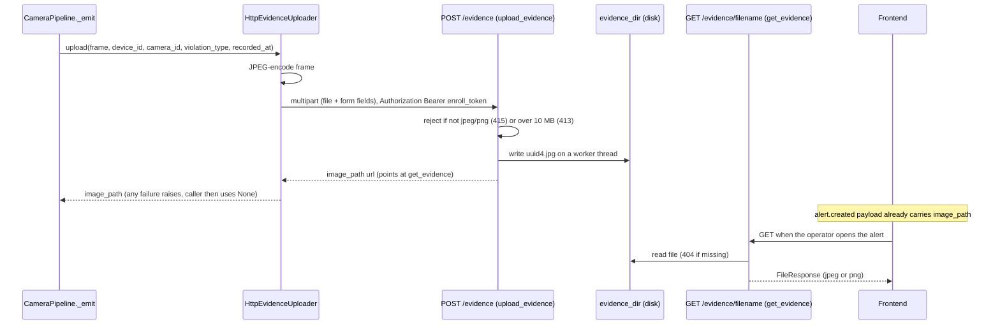

# Flow: evidence upload / fetch

## 1. Overview

**Purpose:**
Give every violation a photo. When the edge emits a violation it grabs the triggering
frame, uploads it to the server over HTTP (not MQTT — an image is far too big for the
control bus), and gets back a URL. That URL rides inside the violation event as
`image_path`; the browser loads the image on demand when an operator opens the alert.

**Scope:**
Two halves. Upload: `CameraPipeline._emit` → `POST /evidence` → stored bytes → `image_path`.
Fetch: browser `GET /evidence/{filename}` → `FileResponse`. Best-effort and off the
critical path: a failed upload still lets the violation go out with `image_path` null.

**Actors / Components:**

* Edge Camera — frame capture, JPEG encode, `HttpEvidenceUploader`
* Backend — `observability` router (`upload_evidence`, `get_evidence`)
* Processing Service — Evidence Service
* Storage — `evidence_dir` on disk (dev) or MinIO / S3 (prod)
* Frontend — alert / incident detail view

---

## 2. High-Level Flow



> Diagram này chỉ thể hiện các component chính. Không đưa class hoặc internal service vào đây.

---

## 3. Sequence Diagram



**Flow:**

1. `CameraPipeline._emit` calls `HttpEvidenceUploader.upload(frame, ...)` before publishing the violation.
2. The uploader JPEG-encodes the frame and POSTs `multipart/form-data` to `POST /api/v1/evidence` with `device_id`, `camera_id`, `violation_type`, `recorded_at`, authenticated with the edge `enroll_token` as a Bearer token.
3. The endpoint rejects non `image/jpeg` / `image/png` (415) or larger than 10 MB (413), writes bytes to `settings.evidence_dir/{uuid4}.jpg` on a worker thread, returns `{ image_path }`.
4. Any exception propagates; `_emit` catches it, logs it, proceeds with `image_path = None`.
5. Later the browser points an `` at `image_path`; `get_evidence` sanitises the filename (`Path(filename).name`) and serves the file, or 404s.

---

## 4. Component Responsibilities

| Component | Responsibility |
| --- | --- |
| Edge Camera | Grab the triggering frame, JPEG-encode, POST with retry-free best effort |
| Evidence Service | Validate content-type and size, write bytes, mint `image_path`, serve on fetch |
| Storage / DB | Hold evidence bytes (disk today, S3 target) |
| Frontend | Fetch and display the image only when the operator opens the alert |

---

## 5. Detailed Service Flow

> Chỉ có section này mới đi sâu vào internal services/classes.



---

## 6. Data Flow

```text
Edge Camera
  │
  │ triggering frame (numpy)
  ▼
HttpEvidenceUploader ──► JPEG bytes
  │
  │ HTTP multipart (Bearer enroll_token)
  ▼
upload_evidence ──► validate (type, size) ──► evidence_dir / MinIO ──► uuid4.jpg
  │
  └──► { image_path }  ──rides inside──►  ViolationPayload.image_path
                                              │
                                              ▼
                                   Frontend   ──► get_evidence ──► file bytes
```

---

## 7. Error Handling

| Failure | Handling |
| --- | --- |
| Network / 4xx / disk error on upload | Exception propagates to `_emit`, logged, `image_path = None` |
| Wrong content type | `415 Unsupported Media Type` |
| File larger than 10 MB | `413 Payload Too Large` |
| Fetch for a missing file | `404`, filename sanitised to `Path(name).name` |
| Slow upload | Must not delay the violation event or the heartbeat — upload and publish are independent |

---

## 8. Observability

**Logs**

* device_id, camera_id, violation_type, byte size, resulting `image_path`
* upload failures with the exception class

**Metrics**

* evidence upload success rate, latency, payload size distribution
* fetch request rate and 404 rate

**Tracing**

* Edge → `POST /evidence` → disk / S3
* Frontend → `GET /evidence/{filename}` → disk / S3

---

## 9. Configuration

| Configuration | Description | Default |
| --- | --- | --- |
| `settings.evidence_dir` | Where uploaded bytes land (dev) | local path |
| max upload size | Rejected above this | `10 MB` |
| accepted types | Allowed content types | `image/jpeg`, `image/png` |
| `enroll_token` | Bearer credential the edge presents | per-device |
| storage backend | `evidence` endpoint (disk) vs `S3EvidenceStore` (target) | disk |

---

## 10. Related Components

* `edge_agent/services/evidence.py` (`HttpEvidenceUploader`)
* `edge_agent/services/pipeline.py` (`_emit`)
* `app/modules/observability/router.py` (`upload_evidence`, `get_evidence`)
* target: `S3EvidenceStore` / `EvidenceStore` protocol
