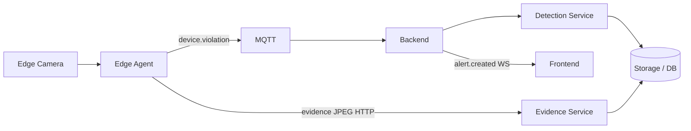
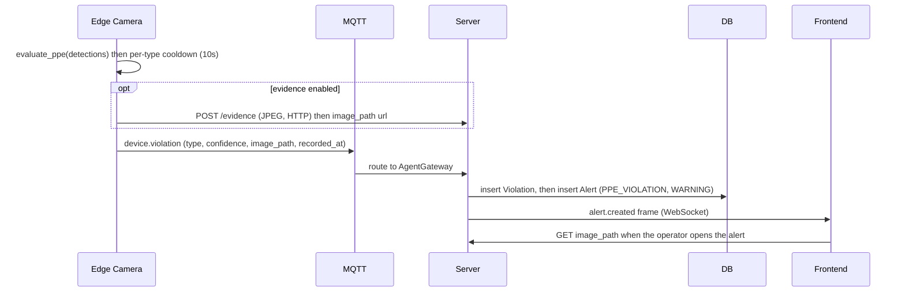
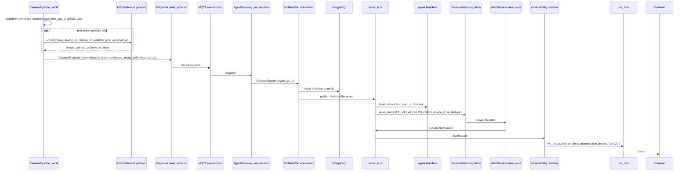

# Flow: violation → alert

## 1. Overview

**Purpose:**
The core business event of the platform: the edge detects a PPE violation (someone
without a helmet, without a vest, …), and the platform records it, attaches a photo,
raises an alert, and shows it on the dashboard in real time. Inference and rule
evaluation happen entirely on the edge — only a small JSON event and (optionally) one
evidence image leave the box.

**Scope:**
Starts when `evaluate_ppe` flags a violation type on an inferred frame at the edge. Ends
when the `alert.created` frame is rendered in the operator's browser (and, on demand, the
evidence image is fetched).

**Actors / Components:**

* Edge Camera — capture, inference, PPE rule, per-type cooldown
* MQTT — `agent/devices/{id}/events` channel
* Backend — AgentGateway, `observability` module, `agent` module
* Processing Service — Detection Service (violation ingest + alert raise), Evidence Service
* Storage — PostgreSQL (violations, alerts), evidence store (disk / S3)
* Frontend — alerts panel

---

## 2. High-Level Flow



> Diagram này chỉ thể hiện các component chính. Không đưa class hoặc internal service vào đây.

---

## 3. Sequence Diagram



**Flow:**

1. For each inferred frame the edge runs `evaluate_ppe(detections, ppe_required)` and gets the set of violation types present.
2. `_emit` applies a per-type cooldown (`min_gap_s`, default 10 s) so one person without a helmet does not generate a storm of events.
3. If an evidence uploader is configured, the triggering frame is uploaded over HTTP and an `image_path` URL comes back; failure leaves `image_path` null.
4. The edge publishes `device.violation` on `agent/devices/{device_id}/events`.
5. The Server validates the payload and records a `Violation` row.
6. `ViolationRecorded` fans out: the device's `last_seen_at` is bumped, and an alert is raised.
7. `AlertService.raise_alert` commits an `Alert` row and publishes `AlertRaised`.
8. The alert is pushed to the browser as an `alert.created` WebSocket frame; the image is fetched only when the operator opens the alert.

---

## 4. Component Responsibilities

| Component | Responsibility |
| --- | --- |
| Edge Camera | Capture frames, run inference, map detections to violation types, apply cooldown |
| MQTT | Carry `device.violation` at-least-once |
| Detection Service | Validate payload, persist `Violation`, raise the `PPE_VIOLATION` alert |
| Evidence Service | Accept the JPEG, store it, return `image_path` |
| Storage / DB | Persist violation rows, alert rows, evidence bytes |
| Frontend | Append the alert live, fetch the evidence image on open |

---

## 5. Detailed Service Flow

> Chỉ có section này mới đi sâu vào internal services/classes.



---

## 6. Data Flow

```text
Edge Camera
  │
  │ frame + detections
  ▼
CameraPipeline.evaluate_ppe ──► violation_type set
  │
  ├── frame ──HTTP──► Evidence Service ──► evidence_dir / MinIO
  │
  └── ViolationPayload ──MQTT (events)──► AgentGateway
                                             │
                                             ├── Violation ──► PostgreSQL
                                             │
                                             └── Alert ──► PostgreSQL
                                                    │
                                                    └── alert.created ──WS──► Frontend
```

---

## 7. Error Handling

| Failure | Handling |
| --- | --- |
| Violation event lost in transit | No retry today (outbox stubbed in edge config); the violation is simply not recorded |
| Evidence upload fails | Caught and logged; event still published with `image_path = null` |
| Alert pipeline error | `Violation` row already committed; only the live push is missed, still queryable via `GET /alerts` |
| DB write fails in `_on_violation` | Exception propagates, gateway logs it; next violation is a fresh attempt |
| Duplicate events for the same incident | Intended — `dedupe=False`; the edge cooldown is the only rate limiter |

---

## 8. Observability

**Logs**

* device_id, camera_id, violation_type, confidence
* whether an evidence image was attached
* alert id once raised

**Metrics**

* violations per device / per type per minute
* evidence upload success rate and latency
* alert raise → WebSocket push latency

**Tracing**

* Edge → MQTT → AgentGateway
* AgentGateway → ViolationService → event_bus → AlertService
* AlertService → observability.realtime → ws_hub → browser

---

## 9. Configuration

| Configuration | Description | Default |
| --- | --- | --- |
| `inference.ppe_required` | Classes that count as required PPE | `["helmet", "vest"]` |
| `min_gap_s` | Per-type event cooldown (`CameraPipeline`) | `10s` |
| `inference.conf_threshold` | Detection sensitivity feeding the rule | model-dependent |
| evidence uploader | Enables the evidence attachment step | enabled when configured |

---

## 10. Related Components

* `edge_agent/analytics/ppe.py` (`evaluate_ppe`)
* `edge_agent/services/pipeline.py` (`_emit`)
* `edge_agent/services/evidence.py` (`HttpEvidenceUploader`)
* `app/edge/gateway.py` (`_on_violation`)
* `app/modules/observability/service.py` (`ViolationService`, `AlertService`)
* `app/modules/observability/integration.py`, `app/modules/observability/realtime.py`
* `app/modules/agent/handlers.py`
* contract: `edge_protocol/messages.py` (`ViolationPayload`)
