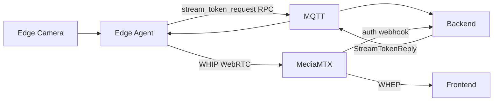
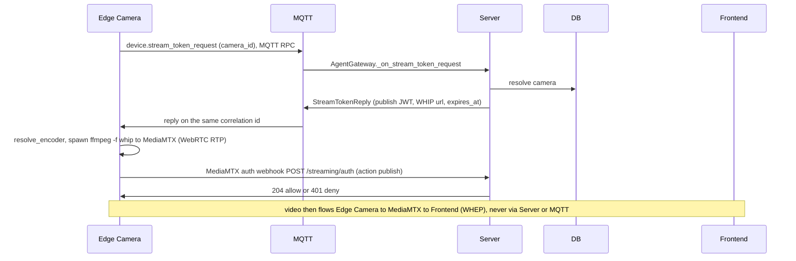
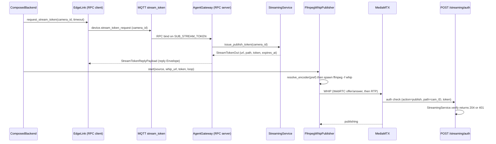

# Flow: edge publishes a camera

## 1. Overview

**Purpose:**
Get a camera's live video off the edge box and into MediaMTX so browsers can watch it.
The video path is pure WebRTC (WHIP to ingest) and never goes through the FastAPI server
or MQTT. The only thing the edge needs from the backend is a short-lived publish token —
and it asks for that over the MQTT link it already has, because the edge agent has no HTTP
login of its own.

**Scope:**
Runs at agent startup, per camera, when `streaming.enabled` is true and the camera has a
server-side `camera_id`. Starts at `ComposedBackend._start_camera_streams`; ends when RTP
is flowing edge → MediaMTX.

**Actors / Components:**

* Edge Camera — `ComposedBackend`, `EdgeLink` RPC client, `FfmpegWhipPublisher`
* MQTT — `agent/devices/{id}/stream_token` RPC channel
* Backend — `AgentGateway._on_stream_token_request`, `StreamingService`, `mediamtx_auth_webhook`
* MediaMTX — WHIP ingest, auth webhook caller
* Storage — PostgreSQL (`camera` rows), `JWT_SECRET`

---

## 2. High-Level Flow



> Diagram này chỉ thể hiện các component chính. Không đưa class hoặc internal service vào đây.

---

## 3. Sequence Diagram



**Flow:**

1. `ComposedBackend._start_camera_streams` iterates the enabled cameras. For each it calls `EdgeLink.request_stream_token(camera_id)` — a request/reply over MQTT (publishes `device.stream_token_request`, waits ~10 s for the reply on the same correlation id).
2. `AgentGateway._on_stream_token_request` (bound as an RPC handler) calls `StreamingService.issue_publish_token(camera_id)`, which mints a signed JWT `{type: stream, path: cam_{camera_id}, action: publish, exp}` (TTL `STREAM_TOKEN_SECONDS`, default 30 s) plus the WHIP URL. It replies with `StreamTokenReplyPayload{url, path, token, expires_at}`.
3. `build_publisher(streaming.kind)` returns a `FfmpegWhipPublisher`. `start(source, whip_url, token, loop)` shells out to `ffmpeg -f whip <url> -headers "Authorization: Bearer <token>"`, one subprocess per camera, independent of the inference loop.
4. `resolve_encoder(pref)` probes `ffmpeg -encoders`; `"auto"` picks the first hardware H.264 encoder (`h264_nvenc`, `h264_vaapi`, `h264_v4l2m2m`) and falls back to `libx264 -preset veryfast -tune zerolatency`.
5. On the incoming WHIP session MediaMTX (`authMethod: http`) calls `POST /api/v1/streaming/auth` with `{action: publish, path: cam_{id}, token}`; `StreamingService.verify` checks the signature and claims, returns 204 or 401.
6. RTP flows edge → MediaMTX. The media session lives on regardless of the token's short expiry.

---

## 4. Component Responsibilities

| Component | Responsibility |
| --- | --- |
| Edge Camera | Ask for a publish token over MQTT, pick an encoder, run one ffmpeg per camera |
| MQTT | Carry the token request/reply RPC (already broker-authenticated) |
| AgentGateway | Bind the RPC handler, no extra device auth needed |
| StreamingService | Mint the publish JWT, verify the MediaMTX webhook |
| MediaMTX | Ingest WHIP, call the auth webhook before publish |
| Storage / DB | Camera rows, `JWT_SECRET` |

---

## 5. Detailed Service Flow

> Chỉ có section này mới đi sâu vào internal services/classes.



---

## 6. Data Flow

```text
Edge Camera source (device index / RTSP / file)
  │
  ├── EdgeLink.request_stream_token ──MQTT RPC──► AgentGateway ──► StreamingService.issue_publish_token
  │                                                                   │
  │        publish JWT + WHIP url  ◄────────────────────────────────────┘
  │
  └── FfmpegWhipPublisher (ffmpeg -f whip, Authorization Bearer token)
        │
        │ WHIP (WebRTC / RTP)
        ▼
      MediaMTX  path cam_{camera_id}
        │
        └── POST /api/v1/streaming/auth (action=publish) ──► StreamingService.verify ──► 204 / 401
```

---

## 7. Error Handling

| Failure | Handling |
| --- | --- |
| One camera fails (no token, ffmpeg won't start, encoder missing) | Caught per camera, logged, `continue`; other cameras and inference keep running |
| Camera has no `camera_id` | Skipped with a warning |
| Token expired before session setup | MediaMTX 401s the publish; retried on the next agent restart (no in-loop retry) |
| Jetson `deepstream` backend | Fuses capture + inference + encode into one GStreamer pipeline; agent core is unaware which backend runs |

---

## 8. Observability

**Logs**

* camera_id, chosen encoder, WHIP url, token expiry
* per-camera ffmpeg start / exit with return code

**Metrics**

* token RPC latency and failure rate
* ffmpeg uptime per camera, restart count
* MediaMTX auth webhook allow / deny counts

**Tracing**

* Edge → MQTT RPC → AgentGateway → StreamingService
* Edge ffmpeg → MediaMTX → auth webhook → StreamingService.verify

---

## 9. Configuration

| Configuration | Description | Default |
| --- | --- | --- |
| `streaming.enabled` | Master switch (edge) | off |
| `streaming.encoder` | `auto` / `nvenc` / `vaapi` / `v4l2m2m` / raw name | `auto` |
| `streaming.bitrate_kbps` | Video bitrate | `2000` |
| `STREAM_TOKEN_SECONDS` | Token TTL (server) | `30` |
| `CAMERAS__n__CAMERA_ID` | Maps a local camera to a server camera row | — |

---

## 10. Related Components

* `edge_agent/services/backend.py` (`ComposedBackend._start_camera_streams`)
* `edge_agent/network/link.py` (`request_stream_token`)
* `edge_agent/streaming/ffmpeg_whip.py` (`FfmpegWhipPublisher`, `resolve_encoder`)
* `app/edge/gateway.py` (`_on_stream_token_request`)
* `app/modules/streaming/service.py`, `app/modules/streaming/router.py` (`mediamtx_auth_webhook`)
* contract: `edge_protocol/messages.py` (`StreamTokenRequestPayload`, `StreamTokenReplyPayload`)
