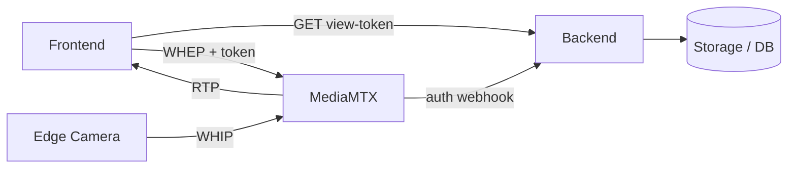
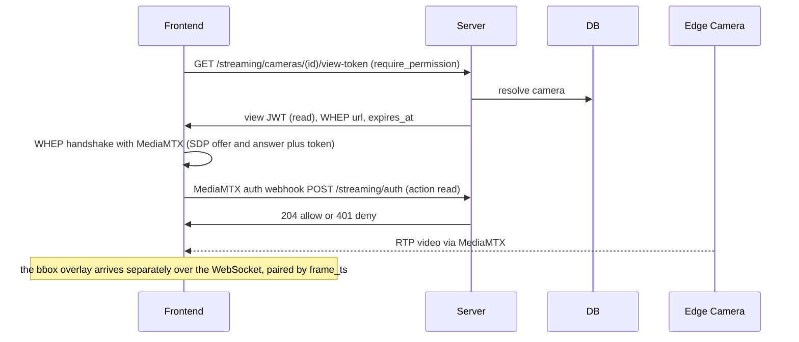
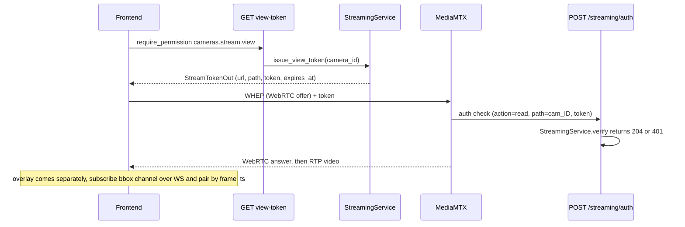

# Flow: frontend views a camera

## 1. Overview

**Purpose:**
Play a camera's live video in the browser. Same principle as the
[edge publish](edge-publish.md) side: the video is pure WebRTC (WHEP playback) straight
from MediaMTX; the backend only issues a short-lived view token that authorises reading
that camera's path.

**Scope:**
Starts when the live monitor panel requests a view token. Ends when RTP is flowing
MediaMTX → browser (the bbox overlay arrives separately, see
[../inference/bbox-overlay.md](../inference/bbox-overlay.md)).

**Actors / Components:**

* Frontend — `LiveMonitorPanel`, WHEP player
* Backend — `streaming/router.py` (`get_view_token`, `mediamtx_auth_webhook`), `StreamingService`
* MediaMTX — WHEP playback, auth webhook caller
* Edge Camera — the upstream publisher (via [edge-publish](edge-publish.md))
* Storage — PostgreSQL (`camera` rows), `JWT_SECRET`

---

## 2. High-Level Flow



> Diagram này chỉ thể hiện các component chính. Không đưa class hoặc internal service vào đây.

---

## 3. Sequence Diagram



**Flow:**

1. The live monitor panel calls `GET /api/v1/streaming/cameras/{camera_id}/view-token` — an authenticated REST call gated by `require_permission("cameras.stream.view")`.
2. `StreamingService.issue_view_token(camera_id)` returns a signed JWT `{type: stream, path: cam_{camera_id}, action: read, exp}` (TTL `STREAM_TOKEN_SECONDS`) plus the WHEP URL.
3. The browser's WebRTC player POSTs an SDP offer to the WHEP URL with the token and gets an SDP answer back.
4. MediaMTX calls `POST /api/v1/streaming/auth` with `{action: read, path: cam_{id}, token}`; `StreamingService.verify` checks signature + claims, returns 204 / 401.
5. RTP flows MediaMTX → browser. If nobody is publishing that path yet the player just waits.
6. In parallel the panel subscribes to the `bbox/{camera_id}` WebSocket channel and pairs boxes to the displayed frame by nearest `frame_ts`.

---

## 4. Component Responsibilities

| Component | Responsibility |
| --- | --- |
| Frontend | Fetch a view token, run the WHEP handshake, render video + overlay |
| Backend | Mint the read JWT (permission-gated), verify the MediaMTX webhook |
| StreamingService | Sign / verify `{type, path, action}` claims |
| MediaMTX | WHEP playback, call the auth webhook before read |
| Edge Camera | Upstream publisher for the path |
| Storage / DB | Camera rows, `JWT_SECRET` |

---

## 5. Detailed Service Flow

> Chỉ có section này mới đi sâu vào internal services/classes.



> There is also `GET /streaming/cameras/{id}/publish-token`
> (`require_permission("cameras.stream.publish")`) for an operator manually restarting a
> stream from the dashboard. The edge agent never uses this — it gets its publish token
> over MQTT ([edge-publish.md](edge-publish.md)).

---

## 6. Data Flow

```text
Frontend
  │
  ├── GET /streaming/cameras/{id}/view-token ──► StreamingService.issue_view_token ──► read JWT + WHEP url
  │
  └── WHEP SDP offer + token ──► MediaMTX  path cam_{id}
        │
        ├── POST /api/v1/streaming/auth (action=read) ──► StreamingService.verify ──► 204 / 401
        └── RTP video ──► Frontend <video>

parallel: bbox/{camera_id} WebSocket ──► overlay boxes paired by frame_ts
```

---

## 7. Error Handling

| Failure | Handling |
| --- | --- |
| Token expires during setup (slow network) | MediaMTX 401s; the player retries with a fresh token |
| No publisher on the path | Black / loading video, no error; starts automatically when the edge begins publishing |
| Permission denied | `GET view-token` returns 403 before any MediaMTX contact |
| Current state | `LiveMonitorPanel` renders `camera.runtime.streamUrl` directly today; the view-token fetch + WHEP handshake is the remaining frontend work |

---

## 8. Observability

**Logs**

* camera_id, requesting user, token expiry
* auth webhook allow / deny with the reason

**Metrics**

* view-token requests, 403 rate
* auth webhook read allow / deny counts
* concurrent WHEP viewers per camera

**Tracing**

* Frontend → GET view-token → StreamingService
* MediaMTX → auth webhook → StreamingService.verify

---

## 9. Configuration

| Configuration | Description | Default |
| --- | --- | --- |
| `STREAM_TOKEN_SECONDS` | View token TTL | `30` |
| `require_permission` | `cameras.stream.view` for viewing, `cameras.stream.publish` for manual publish | RBAC |
| `MEDIAMTX_WHEP_URL` | Base playback URL handed to the browser | env |

---

## 10. Related Components

* `app/modules/streaming/router.py` (`get_view_token`, `get_publish_token`, `mediamtx_auth_webhook`)
* `app/modules/streaming/service.py`
* `frontend/src/modules/agent/components/LiveMonitorPanel.tsx`
