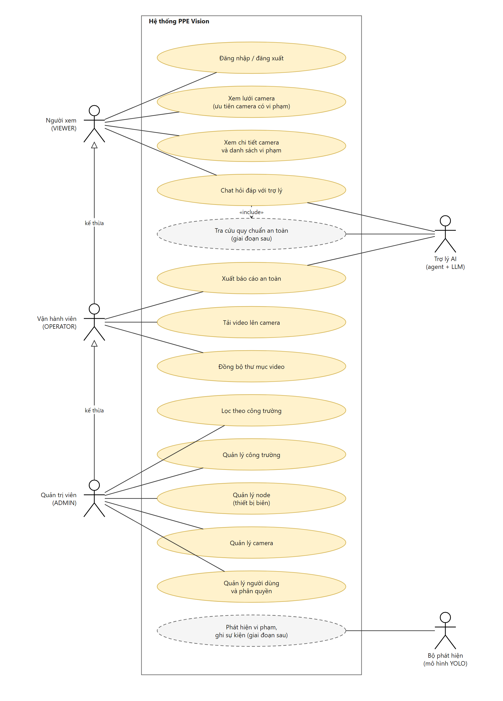
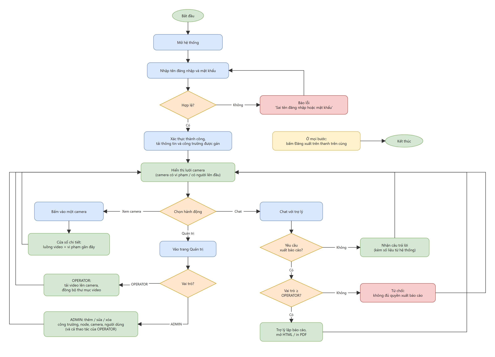
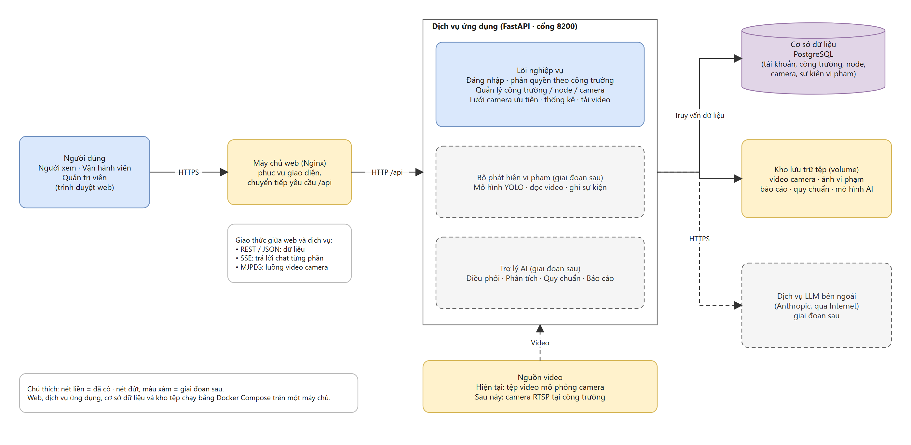
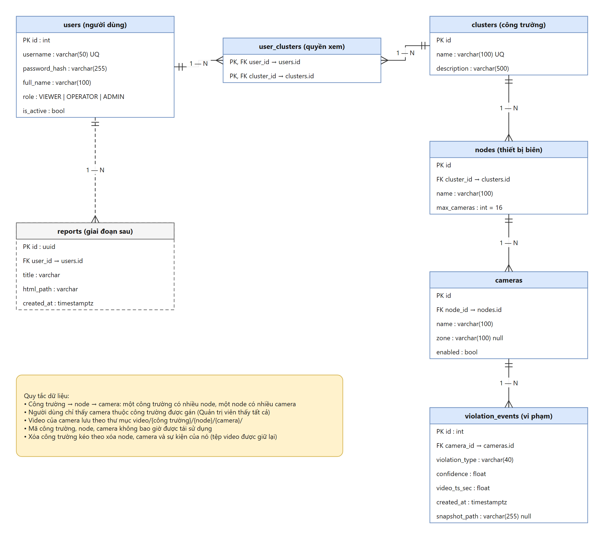
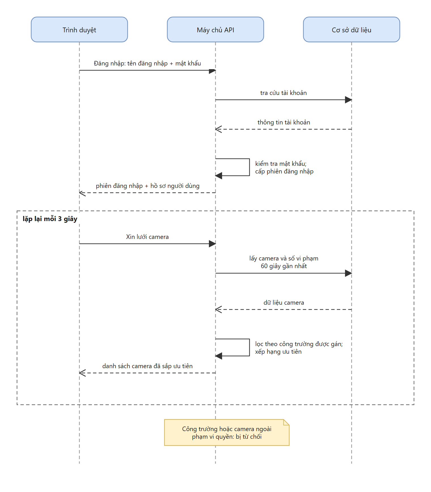
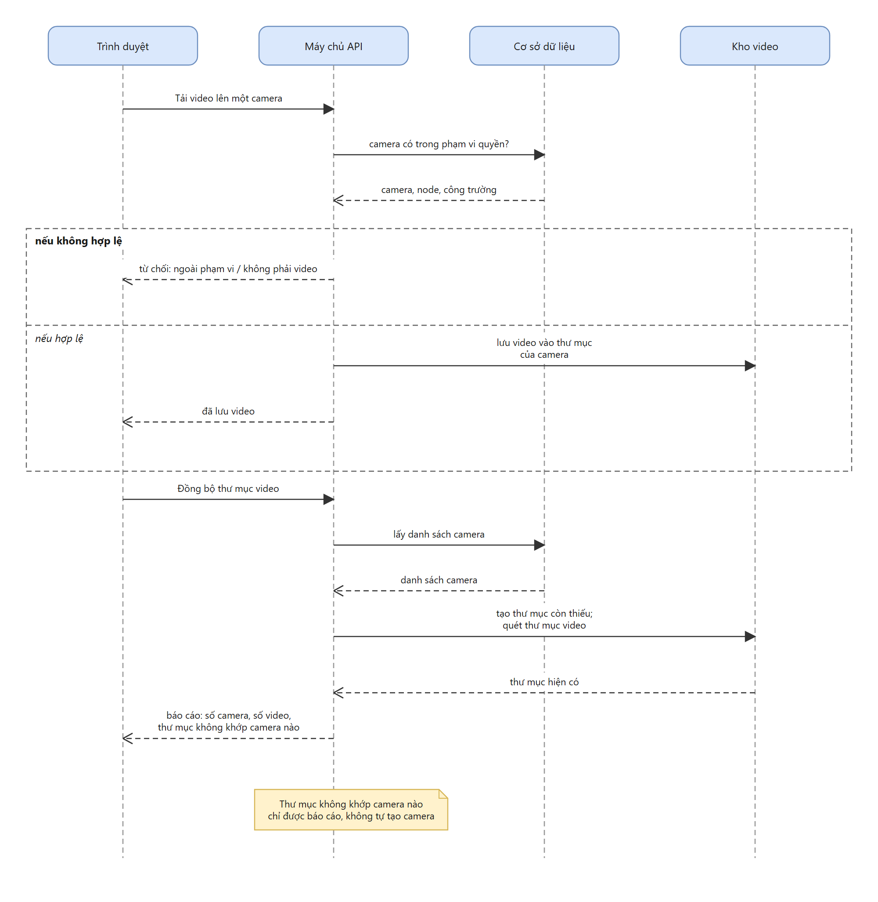
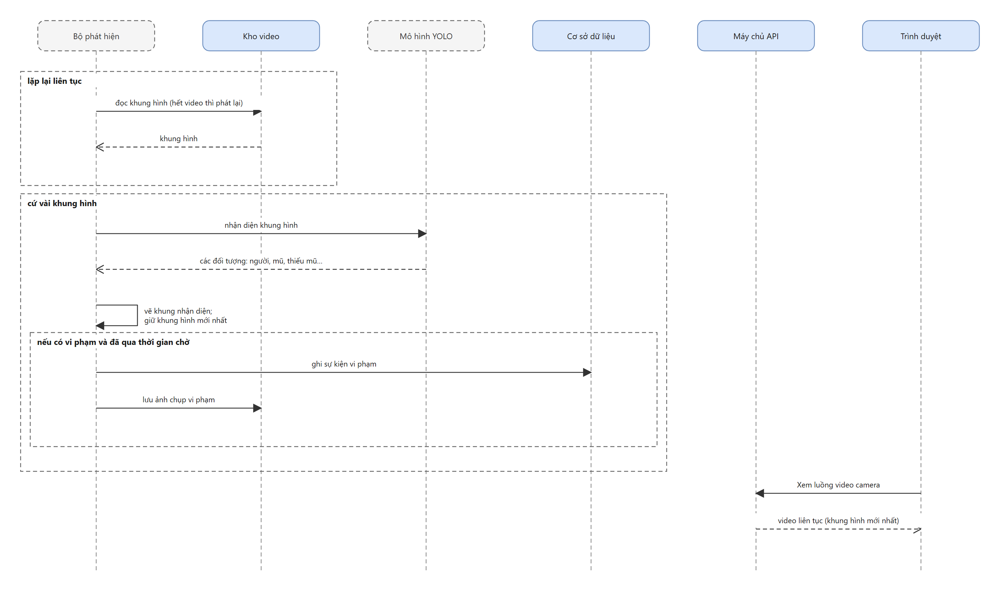
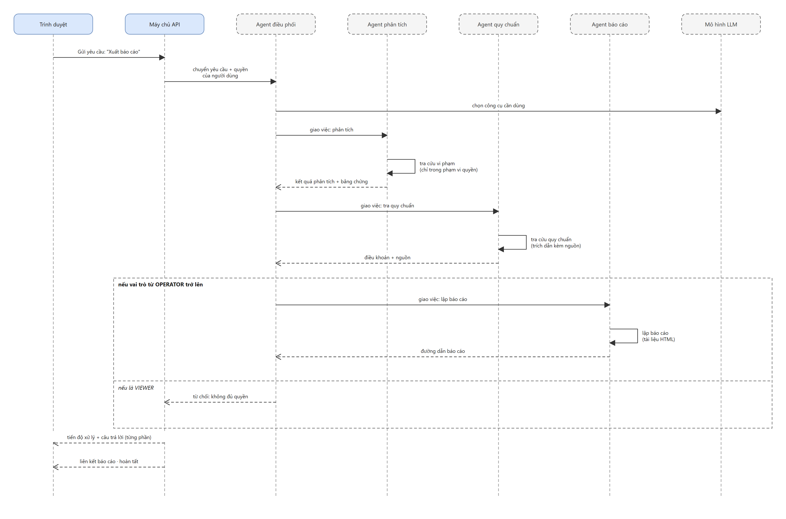

# PPE Vision: tài liệu thiết kế

Hệ thống giám sát vi phạm bảo hộ lao động (PPE) bằng mô hình nhận diện YOLO. Dữ liệu tổ chức theo
**công trường (cluster) → node (thiết bị biên) → camera**. Người dùng có 3 vai trò và chỉ thấy camera thuộc
công trường được gán. Hiện camera là video mô phỏng phát lặp vòng.

> Các tài liệu cũ trong `docs/analysis`, `docs/api`, `docs/architecture` mô tả nền tảng Cloud–Edge trước khi
> viết lại, không còn đúng với bản này. Dùng thư mục `docs/ppe-vision` và `docs/db` làm chuẩn.

## Mục lục

| # | Nội dung | Ảnh | File nguồn (draw.io) |
|---|---|---|---|
| 1 | Use case | [`images/01-use-case.png`](images/01-use-case.png) | [`diagrams/01-use-case.drawio`](diagrams/01-use-case.drawio) |
| 2 | User flow | [`images/02-user-flow.png`](images/02-user-flow.png) | [`diagrams/02-user-flow.drawio`](diagrams/02-user-flow.drawio) |
| 3 | Kiến trúc hệ thống | [`images/03-architecture.png`](images/03-architecture.png) | [`diagrams/03-architecture.drawio`](diagrams/03-architecture.drawio) |
| 4 | ERD | [`images/04-erd.png`](images/04-erd.png) | [`diagrams/04-erd.drawio`](diagrams/04-erd.drawio) |
| 5 | Sequence (4 luồng) | `images/05-sequence-1..4.png` | [`diagrams/05-sequence.drawio`](diagrams/05-sequence.drawio) (4 trang) |
| 6 | Đặc tả API và tool | | [`06-api-tool-spec.md`](06-api-tool-spec.md) |
| 7 | Cấu trúc cơ sở dữ liệu (SQL) | | [`../db/schema.sql`](../db/schema.sql) |

Quy ước màu trong mọi sơ đồ: **xanh dương** = thành phần đã có, **xám nét đứt** = giai đoạn sau,
**vàng** = hạ tầng hoặc ghi chú, **xanh lá** = kết quả tốt, **đỏ** = lỗi hoặc từ chối.

## 1. Use case



Ba vai trò người dùng kế thừa nhau: ADMIN ⊃ OPERATOR ⊃ VIEWER. Hai tác nhân hệ thống là *Trợ lý AI* và
*Bộ phát hiện (YOLO)*, cả hai thuộc giai đoạn sau.

| Vai trò | Use case |
|---|---|
| VIEWER | Đăng nhập; xem lưới camera; xem chi tiết camera và vi phạm; chat hỏi đáp |
| OPERATOR (thêm) | Xuất báo cáo; tải video lên camera; đồng bộ thư mục video |
| ADMIN (thêm) | Lọc theo công trường; quản lý công trường, node, camera, người dùng và phân quyền |

## 2. User flow



Luồng một phiên làm việc: đăng nhập, xem lưới camera, rồi chọn xem camera, chat hoặc quản trị. Hai điểm
rẽ nhánh theo quyền: xuất báo cáo yêu cầu vai trò từ OPERATOR trở lên; trang Quản trị cho OPERATOR chỉ
tải video và đồng bộ thư mục, còn ADMIN làm được cả thêm, sửa, xóa.

## 3. Kiến trúc hệ thống



Sơ đồ mô tả web nói chuyện với backend ra sao, và backend nói chuyện với hạ tầng ra sao:

| Từ | Đến | Giao thức |
|---|---|---|
| Trình duyệt | Máy chủ web (Nginx) | HTTPS |
| Máy chủ web | Dịch vụ ứng dụng | HTTP `/api`: REST/JSON cho dữ liệu, SSE cho chat, MJPEG cho video |
| Dịch vụ ứng dụng | Cơ sở dữ liệu PostgreSQL | Truy vấn dữ liệu |
| Dịch vụ ứng dụng | Kho lưu trữ tệp (volume) | Đọc, ghi tệp: video, ảnh vi phạm, báo cáo, quy chuẩn, mô hình AI |
| Dịch vụ ứng dụng | Dịch vụ LLM bên ngoài *(giai đoạn sau)* | HTTPS |
| Nguồn video | Dịch vụ ứng dụng *(bộ phát hiện, giai đoạn sau)* | Hiện là tệp video mô phỏng, sau này là camera RTSP |

Web, dịch vụ ứng dụng, cơ sở dữ liệu và kho tệp chạy bằng Docker Compose trên một máy chủ.

## 4. ERD



| Bảng | Vai trò |
|---|---|
| `clusters` | Công trường |
| `nodes` | Thiết bị biên trong công trường, có `max_cameras` |
| `cameras` | Nguồn video gắn vào node; `zone` là chữ tự do (tầng, cổng) |
| `violation_events` | Mỗi vi phạm ghi nhận: loại, độ tin cậy, thời điểm, ảnh |
| `users` | Tài khoản; `role` ∈ VIEWER, OPERATOR, ADMIN |
| `user_clusters` | Nhiều-nhiều: người dùng được xem công trường nào |
| `reports` *(giai đoạn sau)* | Báo cáo đã xuất |

SQL tạo bảng: [`../db/schema.sql`](../db/schema.sql).

## 5. Sequence

| Luồng | Ảnh | Trạng thái |
|---|---|---|
| S1. Đăng nhập và xem lưới camera (làm mới mỗi 3 giây) |  | Có |
| S2. Tải video lên camera và đồng bộ thư mục (Operator) |  | Có |
| S3. Phát hiện vi phạm: đọc khung hình, nhận diện, ghi sự kiện, phát video |  | Giai đoạn sau |
| S4. Chat và xuất báo cáo qua bốn agent |  | Giai đoạn sau |

## 6. Đặc tả API và tool

Xem [`06-api-tool-spec.md`](06-api-tool-spec.md): bảng endpoint với quyền và mã lỗi, định dạng sự kiện SSE của chat,
đặc tả 4 agent cùng các tool.

## Lưu trữ video

```
volume/data/video/{cluster_id}/{node_id}/{camera_id}/*.mp4
```

Camera phát các file trong thư mục theo thứ tự tên, lặp vòng. Cơ sở dữ liệu là nguồn sự thật: thư mục
không khớp camera nào chỉ được *báo cáo* khi đồng bộ, không bao giờ tự tạo camera.

## Tái tạo sơ đồ và schema

Chạy từ thư mục `app/`.

```
# 1. Sinh lại các file .drawio (ghi đè)
python docs/ppe-vision/diagrams/gen_drawio.py docs/ppe-vision/diagrams

# 2. Xuất ảnh PNG từ các file .drawio, cần Chrome (không gửi dữ liệu ra ngoài)
python docs/ppe-vision/diagrams/export_images.py docs/ppe-vision/diagrams docs/ppe-vision/images

# 3. Sinh lại docs/db/schema.sql từ mô hình dữ liệu
python docs/db/generate_schema.py
```

Sửa nhỏ thì sửa thẳng trong draw.io rồi chạy bước 2 để cập nhật ảnh. Sửa trong draw.io sẽ bị ghi đè nếu
chạy lại bước 1.

`export_images.py` tự vẽ phần draw.io mà các sơ đồ này dùng (hình chữ nhật, elip, hình thoi, actor, bảng
swimlane, ghi chú, đường nối thẳng và vuông góc, ký hiệu ER). Nó không phải trình vẽ draw.io tổng quát: nếu
bạn thêm hình lạ trong draw.io thì ảnh xuất ra có thể thiếu hình đó.
